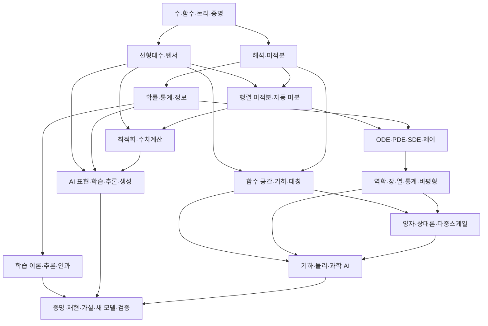

# AI를 위한 물리와 수학 확장형 교육과정

**Physics and Mathematics for AI**는 AI의 개념을 이해하고, 학습·추론·생성의 동작을 유도하고,
새로운 연구 문제와 방법을 설계하는 데 필요한 수학과 물리를 기초부터 연구 수준까지
축적하는 교재다. 주차·학기·전체 장 수·페이지 수에 상한을 두지 않는다.

목차는 선수 지식 그래프로 관리한다. 연구에 필요한 개념을 발견하면 정의·유도·증명·실험·근거를
갖춘 장과 절을 추가한다. 현재 색인은 최초 설계 범위이며 교재의 최종 분량이 아니다.
현재 작성된 원고와 장면 설계의 준비 상태는 교육과정 전체의 집필 상태와 별도로 표시한다.

## 학습의 최종 목표

1. 모델의 입력·표현·목적·학습·추론을 수학적 객체와 연산으로 설명한다.
2. 핵심 식을 직접 유도하고 차원·정의역·가정·반례·계산 안정성을 검토한다.
3. 확률·최적화·동역학·물리 모델의 관계와 적용 조건을 구분한다.
4. 연구 논문의 정리·알고리즘·실험을 재구성하고 작은 기준 예제로 재현한다.
5. 설명되지 않은 현상에서 검증 가능한 가설을 만들고 모델·해법·목적함수·증명·실험을 설계한다.

## 교재 구성 문서

| 문서 | 역할 |
| --- | --- |
| [지식 영역 상세 색인](physics-math-for-ai/curriculum/catalog.md) | 기초와 심화 주제, 성취 기준, AI 연결, 시각화·실험 |
| [선수 지식 데이터](physics-math-for-ai/curriculum/knowledge-map.json) | 기간 제한이 없는 영역 ID와 선수 관계, 향후 탐색 UI의 근거 |
| [AI 동작과 연구 경로](physics-math-for-ai/curriculum/ai-research-paths.md) | 모델별 수학·물리 역추적, 전체·목적별 학습 경로, 연구 과제 |
| [집필과 연구 검증 기준](physics-math-for-ai/curriculum/authoring-and-research.md) | 단원의 깊이, 증명·실험·새 연구, 확장·진도 정책 |
| [교육·논문 근거](physics-math-for-ai/curriculum/sources.md) | 확인한 원문과 단원별 참고 자료를 추가하는 방식 |
| [읽기·실험 화면 설계](physics-math-for-ai/reader-design.md) | 학습 동선, 상태, 접근성, 초기 시각화 구현 계약 |

## 교육과정의 전체 범위

각 행은 여러 권·장·절로 확장할 수 있는 학습 영역이다. 순서 번호나 주차가 아니다.
세부 주제와 선수 영역은 상세 색인에 둔다.

| 영역 | 다룰 내용 | 도달할 능력 |
| --- | --- | --- |
| 수학의 언어와 기초 | 수·함수·좌표, 논리·집합·증명, 조합·그래프·형식 구조 | 정의를 읽고 주장·가정·증명·반례를 구분 |
| 대수와 해석 | 선형대수·행렬 분석, 다중선형·텐서, 추상대수, 실·복소 해석 | 표현과 변환·근사·연산의 구조를 유도 |
| 미분과 함수 공간 | 다변수·행렬 미적분, 함수해석·연산자·Sobolev, 근사·커널 | 역전파와 함수·연산자 학습의 수학을 설명 |
| 기하·대칭·신호 | 미분기하·위상, 군·Lie 대칭·표현론, Fourier·wavelet | 공간·대칭·주파수에 맞는 표현과 모델을 설계 |
| 확률·통계·추론 | 기초·측도론적 확률, 고차원 확률, 추정·검정, Bayes·그래프 모델 | 관측·분포·잠재변수·불확실성을 정식화 |
| 정보·부호·계산 | entropy·KL·상호정보량, 압축·부호·알고리즘 정보 | 목적함수·정보·기술 길이·계산 한계를 구분 |
| 최적화와 수치계산 | 볼록·비볼록·확률·기하 최적화, 변분·최적수송, AD·정밀도·안정성 | 학습 규칙과 계산 오차·수렴 조건을 분석 |
| 동역학·결정 | ODE·PDE·SDE, 과학계산, 제어·최적제어·RL, 게임·조합 최적화 | 연속·이산·확률 상태의 변화와 의사결정을 모델링 |
| 학습·인과·신뢰성 | 일반화·표현력·학습 복잡도, 인과·식별, 강건성·프라이버시의 수학 | 성능 주장과 이론·실험 보장을 조건 안에서 검토 |
| 역학과 연속장 | 측정·차원, Newton·Lagrange·Hamilton, 파동·광학·전자기·연속체 | 물리 법칙과 경계·보존·센서·관측을 연결 |
| 열·통계·비평형 | 열역학·ensemble·분배함수·상전이·확률 흐름·비평형 | 미시·거시·확률·에너지 모델의 관계를 설명 |
| 양자·장이론·시공간 | 양자역학·양자정보·다체, 장·다중스케일·상대론 | 해당 과학 AI 연구에 필요한 상태·대칭·관측을 이해 |
| 물질과 계산 장치 | 고체·반도체·회로·광학·물리 계산, 열·통신·메모리 비용 | 수학적 계산량과 실제 물리적 자원을 구분 |
| 연구로의 통합 | 역문제·실험 설계·수치 검증·증명·논문 재현·새 가설 | 기존 원리를 검토하고 새로운 연구를 수행 |

전자기학·양자·상대론도 교재 전체의 학습 범위에 포함한다. 각 영역은 일반적인 AI 동작에
공통으로 필요한 부분과 특정 연구 분야에 진입할 때 필요한 부분을 구분해 표시한다.
예를 들어 Transformer의 내적·정규화·확률 목적은 관련 수학에서 설명하고, 양자 AI나
전자기 역문제에서는 추가 물리 단원으로 연결한다. 물리적 비유를 모든 AI의 필수 설명으로
사용하지 않는다.

## 시간 대신 선수 지식과 성취 기준으로 학습

학습자는 전체 정독 경로 또는 연구 목적별 경로를 선택한다. 전체 정독 경로에서는 모든
등록 영역을 선수 관계에 따라 순환 없이 탐색하고, 새로 확장된 단원도 계속 학습할 수 있다.
목적별 경로에서는 필요한 선수 절을 확인하며 모델·논문으로 왕복한다.

영역 이름은 분류이며 그 영역 전체의 이수를 모든 다음 단원의 진입 조건으로 강제하지 않는다.
필수 선수 절, 병행 가능한 내용, 보충 설명, 연구 심화를 단원 수준에서 지정한다.
고급 주제도 직관·작은 예제부터 진입한 뒤 정식 정의와 증명으로 확장한다.

완료는 주차 경과가 아니라 **설명·유도·검산·재현·전이·연구 질문**의 충족으로 판단한다.
진도는 선택한 경로와 단원 버전 기준으로 기록하며, 계속 확장되는 전체 교재의 고정 백분율을
졸업 기준으로 사용하지 않는다.

## 대표 선수 연결

아래는 전체 지식 지도 중 대표 연결이다. 각 화살표는 해당 영역의 필요한 선수 절을 뜻하며,
연구 분야별 물리 전체를 일반적인 AI의 진입 조건으로 만들지 않는다.

## 단원의 내용과 깊이

각 개념은 필요에 따라 여러 장과 절로 전개하며 다음을 제공한다.

- 현상·문제·정의·기호와 선수 개념.
- 직관과 개념 그림, 정식 유도·정리·증명·반례.
- 가정·유효 범위·단위·경계 조건·오차.
- 계산 가능한 작은 예제와 같은 기준을 사용하는 시각화·수치 실험.
- AI 내부의 실제 연산·목적·추론과의 연결.
- 원 논문 읽기, 재현, 조건을 바꾸는 실험, 새로운 연구 질문과 검증 계획.

설명은 직관 → 계산 → 정식화 → 모델 동작 → 연구의 깊이로 이어진다. 어려운 정의나
증명이 길어진다는 이유로 생략하거나 한 수업 분량으로 압축하지 않는다.
상세 집필 양식은 [집필 기준](physics-math-for-ai/curriculum/authoring-and-research.md)을 따른다.

## 시각화와 학습 경험

한 절의 흐름은 현상과 질문 → 예측 → 수식·유도 → 직접 조작 → 해설 → 검증·도전 과제다.
Three.js는 공간·기하·물리·장·동역학을 조작하는 장면에 사용한다. 확률 표, 논리 그래프,
증명, 수렴 표와 같은 내용에는 2D 그림·텍스트·수식을 함께 사용한다.
고차원·무한차원·양자 상태를 보여 주는 3D 장면에는 투영·단면·근사의 의미를 명시한다.

본문과 조작 버튼은 실제 HTML로 두고, 데스크톱은 본문/실험 두 열, 모바일은 세로로 배치한다.
키보드·모션 감소·WebGL 대체 보기에서도 같은 설명·입력·계산 결과에 접근할 수 있게 한다.
[Every Joule](https://iamtechartist.com/every-joule/)의 책과 실험을 연결한 학습 경험을 참고한다.

## 초기 제작물과 구현 순서

교육과정 전체는 위 범위로 계속 확장한다. 초기 구현은 아래 세 장면으로 공통 학습 화면과
수학·물리 계산 계약을 검증한다. 이 구현 순서가 교재의 최종 목차를 정하지 않는다.

| 주제 ID | 준비된 자료 | 초기 구현의 확인 사항 |
| --- | --- | --- |
| `vectors-and-forces` | 한·영 본문, SVG, 수식·3D·2D·확인 문제 | 성분·크기·힘·가속도·초기 상태와 단위 |
| `linear-transforms` | 한·영 본문, 수식·3D·2D·확인 문제 | 기저·점·격자, 행렬식의 부호·부피·특이성 |
| `gradients` | 한·영 본문, 수식·3D·2D·손실 그래프·확인 문제 | 미분·갱신·학습률·목적값, 경계·발산·정지점 |

위 시범 단원을 확장하여 현재 논리·기초수학·이산수학과 벡터·내적·행렬·최소제곱·고유값·그래디언트·연쇄법칙·Jacobian·역전파와 SVD·확률·통계·Bayes·정보·정규화·SGD·동역학·물리·역문제·연구 검증의 여든여섯 단원을
구현했다. [순차 구현 기록](physics-math-for-ai/implementation-sequence.md)에 실제 읽기
경로와 후속 집필 순서를 정리한다. 열어볼 경로와 모델 규약은
[시범 구현 기록](physics-math-for-ai/preview-implementation.md)에 정리한다.

기존 숫자 접두 파일명은 시범 자료 식별용으로 유지한다. 전체 교재에서는 의미 기반 ID와
선수 관계를 사용하며 화면의 순서는 선택한 학습 경로에서 만든다.

## 구현 구조와 공개 기준

Markdown 집필 방식과 정적 배포를 활용한다. 도서 → 지식 영역 → 장·단원 → 절 → 장면으로
구성하고, 원고 경로·언어·선수 관계·참고 논문·준비 상태를 레지스트리에서 관리한다.
데이터와 로더는 페이지에서 조립하고 `lib/`는 정적 데이터를 인자로 받는다.

원고에는 수식과 코드 강조를 지원하고, 한·영 본문·문항·해설을 함께 준비한다.
모델 계산은 렌더러와 분리해 숫자·단위·정답·그림이 같은 상태를 읽도록 한다.
자동 진행은 모션 설정·탭·장면 가시성을 따르며 수동 입력·단계 이동은 유지한다.
경로 이동 시 GPU 자원을 정리하고 WebGL 실패 시 본문·정적 그림·수치 표를 제공한다.

공개 경로는 `/book/online/physics-math-for-ai/`와 그 아래 의미 기반 단원 경로로 설계한다.
준비된 단원에서만 정적 경로·검색·사이트맵을 생성한다. 미집필·집필·검토·실행 검증·공개
상태를 나눠 계획된 내용을 실제 제공되는 교재로 표시하지 않는다.

공개 전에 정의·증명·가정·단위·기준 수치·한영 일치·모바일·키보드·모션 감소·대체 보기와
관련 논문을 검토한다. 단순한 그림의 동작 확인을 수학적 증명이나 연구 결과의 재현으로
표시하지 않는다. Python Programming Colab 시범 과정은 별도 제작 범위로 관리한다.

현재 읽기 경로 앞에 논리·양화사·집합과 함수·관계와 순서·증명 전략·귀납법 6개 단원을 추가했다.
기존 단원의 URL·저장 키는 유지하며, 전체 51개 영역의 세부 집필 상태는 구현 범위 장부에서 별도로 추적한다.

논리 기초 뒤에 수·분수·단위, 실수·복소수, 방정식·부등식, 다항·유리함수, 지수·로그,
삼각·좌표, 합성·역함수, 수열·급수, 점근 표기 9개 단원을 추가했다. 다음 미집필 영역은 이산수학이다.

## 이산수학 확장 (2026-10-28)

세기·조합, 이항계수·포함배제, 점화식·생성함수, 그래프·트리·DAG, 경로·연결성,
Boolean 대수, DFA·형식언어, 부분순서·격자, 유한 전이의 아홉 단원을 추가했다.
현재 47개 단원이며 한·영 본문, 4단계 개념도, 3개 안내 실험, 2개 확인 문항을 갖춘다.
`npm run check:discrete`로 브라우저 검사를 실행한다. 다음 미집필 주제는 선형대수의
기저·차원·랭크·영공간 등이며, 51개 영역 전체의 완성을 뜻하지 않는다.

## 선형 구조 보완 (2026-10-28)

기저·차원·랭크·영공간, 행렬식·trace, 양의 준정부호, 이차형식·행렬 순서, Kronecker 곱의
다섯 단원을 SVD 뒤에 추가해 현재 52개 단원이다. SVD의 의사역행렬·최소 노름 해도 보완했다.
새 단원은 한·영 본문과 20개 개념 단계·15개 안내 실험·10개 확인 문항을 제공한다.
`npm run check:matrix-structures`로 브라우저 검사를 실행한다. 다음 미집필 영역은 해석학이며,
범위 장부의 원고 근거는 입문 수준의 연결을 뜻한다. 전체 교육과정의 완료를 뜻하지 않는다.

## 해석학·다변수 미적분과 전체 지도 (2026-10-28)

해석학 9개·다변수 미적분 6개 단원을 추가해 현재 67개 단원이다. 극한·미분·적분·Taylor·급수·
균등 수렴·compactness·볼록성·적분 교환, 암묵 미분·logdet·벡터장·기하 적분·Gauss/Stokes·HVP를 다룬다.
교재 목차에는 전체 51개 영역·509개 세부 주제의 한·영 범위·선수·읽기 연결·검색을 제공한다.
집필 예정과 실제 읽기 단원을 구분하며 전체 심화 교육과정은 아직 미완료다.
새 실습 검사는 `npm run check:analysis`, 지도 동기화는 `npm run learning:curriculum`이다.

## 복소해석 확장 (2026-10-28)

복소 극형식·정칙성과 CR·경로 적분·유수·특이점·해석적 연속과 가지·Hermitian 내적·Wirtinger·
위상 간섭의 아홉 단원을 추가해 현재 76개 단원이다. 원고 18개와 36개 개념 단계·27개 안내 실험·18개 확인 문항을 제공한다.
범위 지도에도 읽기 단원을 연결했다. `npm run check:complex`로 새 실습을 확인한다.
입문 원고 근거는 영역의 심화 완료를 뜻하지 않는다. 다음 미집필 영역은 텐서·다중선형대수다.

## 텐서·다중선형대수 집필

열 단원을 추가해 현재 86개 한·영 입문 단원이다. shape·축 순열·수축·다중선형성·broadcasting을
작은 배열의 실제 값으로 설명하고, CP/Tucker·TT 복원과 저랭크 오차·수축 순서·대칭성·저장 비용을
조작할 수 있다. 다음 집필 영역은 추상대수다. 전체 지식 지도 509개 주제의 완성을 뜻하지 않는다.

## 추상대수 입문 단원 추가 (2026-10-29)

현재 95개 한·영 입문 단원이다. 추상대수 아홉 단원에 원고 18개, 개념 단계 36개, 안내 실험 27개와
확인 문항 18개를 추가했다. 모듈러 연산·대표원·몫·유한체·군 작용·불변량·등변 사영을 실제 값으로 비교한다.
기존 테마의 SVG와 좌표별 계산 표를 사용한다. 다음 집필 순서는 확률 기초의 상세 확장이다.

## 확률과 확률변수 상세 확장 (2026-10-29)

현재 103개 한·영 입문 단원이다. 확률 기초 여덟 단원에 원고 16개, 개념 단계 32개,
안내 실험 24개와 확인 문항 16개를 추가했다. 사건·조건부·CDF·결합분포·Gaussian·변환·
LLN/CLT·재매개화를 실제 계산과 그림으로 설명한다. 다음 순서는 측도론적 확률이다.
전체 509개 주제의 심화 집필 완료 선언이 아니다.
