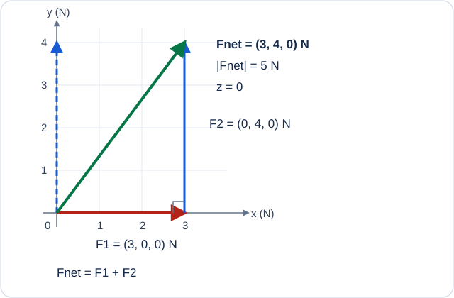

# Vectors and the Sum of Forces

Physics and Mathematics for AI · English manuscript draft · Scene `vectors-and-forces`.
The 3D experiment is planned in the [scene specification](01-vectors-and-forces.scene.json).

## What you will learn

- Distinguish vector components, direction, and magnitude, and add two vectors.
- Distinguish rotating the camera from changing a vector.
- Calculate acceleration from net force and mass, checking the units.

A vector represents magnitude and direction. After choosing a coordinate system, we
can represent it using three components `(x, y, z)`. Read the components together with their units.

## Predict first

Two forces act on the same object. The first is 3 N along the x-axis. The second is
4 N along the perpendicular y-axis. What is the magnitude of their sum?

Question `Q01`:

- `A`: 7 N
- `B`: 5 N
- `C`: 1 N

Before choosing, draw the force arrows head to tail and connect the starting point to the final tip.

## Adding components determines the direction

Write the forces as vectors:

$$
\mathbf{F}_1=(3,0,0)\,\mathrm{N},\qquad
\mathbf{F}_2=(0,4,0)\,\mathrm{N}.
$$

Add the corresponding components to obtain the net force:

$$
\mathbf{F}_{\mathrm{net}}=\mathbf{F}_1+\mathbf{F}_2
=(3,4,0)\,\mathrm{N}.
$$

The magnitude is the square root of the sum of the squared components:

$$
\|\mathbf{F}_{\mathrm{net}}\|=\sqrt{3^2+4^2+0^2}=5\,\mathrm{N}.
$$

The answer to `Q01` is `B`. Adding the magnitudes directly gives 7 N, which is correct
when the forces point in the same direction. Ignoring direction gives the wrong net force.

## Experiments to explore in the scene

The planned scene labels the two forces and their sum with different line styles,
symbols, and the labels `F1`, `F2`, and `Fnet`. Placing the second arrow at the tip of
the first shows that the net arrow joins the starting point to the final tip.

1. Set the forces to `(3,0,0)` and `(0,4,0)`, then check the net force and its magnitude.
2. Change the second force to `(3,0,0)` and explain the resulting magnitude of 6 N.
3. Change it to `(-3,0,0)` and check that the net force is zero.
4. Rotate only the camera. The image changes, but the coordinate system and force components do not.
5. Change a z-component to connect a flat drawing with a vector in space.

## How force changes motion

For a particle of constant mass, Newton's second law relates net force to acceleration.
Our example uses an inertial coordinate system and assumes that no other forces act.

$$
\mathbf{a}=\frac{\mathbf{F}_{\mathrm{net}}}{m}.
$$

For a mass of 2 kg:

$$
\mathbf{a}=(1.5,2,0)\,\mathrm{m/s^2},\qquad
\|\mathbf{a}\|=2.5\,\mathrm{m/s^2}.
$$

Question `Q02`: What happens to acceleration if you double the mass while keeping the forces fixed?

Every acceleration component and its magnitude are halved. The force magnitude of
5 N and the acceleration magnitude of 2.5 m/s² are different quantities. Check both numbers and units.

## Follow the motion over time

Start at the origin with zero velocity and apply the constant force for two seconds.
Constant acceleration allows us to use:

$$
\mathbf{v}(t)=\mathbf{v}_0+\mathbf{a}t,\qquad
\mathbf{r}(t)=\mathbf{r}_0+\mathbf{v}_0t+\tfrac12\mathbf{a}t^2.
$$

At two seconds, velocity is `(3,4,0)` m/s and position is `(3,4,0)` m. The matching
component numbers have different units and meanings. This example excludes gravity,
friction, and collisions. The external force stays constant, so these equations apply throughout.

## Does zero net force always mean no motion?

Question `Q03`: The forces cancel, and the initial velocity is `(1,0,0)` m/s. What are
velocity and position after two seconds if the initial position is the origin?

Acceleration is zero, so velocity stays `(1,0,0)` m/s and position becomes `(2,0,0)` m.
Zero net force means that velocity does not change. An object remains at rest only
if it was initially at rest. Without a decelerating force, it does not stop by itself.

## Meeting vectors again in AI

Feature-vector addition and weighted combinations also use component-wise operations.
Dividing `(3,4,0)` by its magnitude, 5, gives the unit direction `(0.6,0.8,0)`.
Dividing a force vector by its magnitude gives a dimensionless direction, distinct from the original 5 N force.

An AI feature vector need not represent a physical force or distance. Here we connect
the component-wise calculation; the meaning and units are determined by each problem.

## Challenge

Keep the first force at `(3,0,0)` N. Choose a second force that gives a net force of
`(0,4,0)` N. The second force must be `(-3,4,0)` N. Check each component and explain
the result using a head-to-tail drawing of the arrows.

## Reference cases and the next lesson

Check the calculations against `perpendicular-forces`, `cancelled-at-rest`, and
`cancelled-while-moving` in the [reference scenarios](01-vectors-and-forces.scene.json).
A suggested next topic is linear transformations of vectors and coordinate grids.
Check the prerequisite units and follow your selected path through the wider curriculum.

For the relationship between force and acceleration, see
[OpenStax on Newton's second law](https://openstax.org/books/university-physics-volume-1/pages/5-3-newtons-second-law).
The numerical examples and questions here use the assumptions stated in this lesson.
