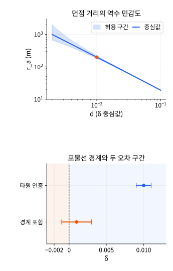
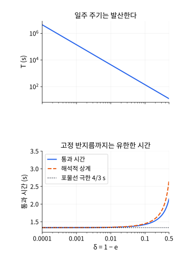

# 포물선 경계의 궤도 불확실성과 통과 시간: 후속 계산 기반

2026-11-12. 다음 `inverse-square-effective-potential`·`elliptic-kepler-time-area`의 심화 계산 기반이다. 기존 모델·한영 본문·독립 참조와 입력 범위를 대조한 뒤, 먼점·주기의 민감도와 유한한 근점 통과 시간을 연결했다. **한영 학습 본문 통합 전**이며 보강 단원/영역 완료 집계를 올리지 않는다. 원래 실습은 역제곱력의 에너지 허용 구간과 제한된 타원 가족의 시간 해다.

## 1. 작은 에너지 불확실성과 거대한 먼점 구간

관성계의 고정 원천 가속도 q''=−μq/r³, μ>0를 유지한다. 입자는 양의 근점 반지름 rp에서 순수 접선 양의 속도 vp로 출발한다. 다음은 **비방사 운동**의 근점 가족이며 h=0의 충돌 분기에 적용하지 않는다.

### 포물선 경계와의 무차원 거리

$$
\delta=1-e=2-\frac{r_pv_p^2}{\mu},\qquad
\epsilon=-\frac{\mu\delta}{2r_p},\qquad
h^2=\mu r_p(2-\delta).
$$

δ<1이면 출발점은 근점이며 h≠0이다. 0<δ<1은 비원형 타원, δ=0은 포물선, δ<0은 쌍곡선이다. 이는 초기 반지름 속도가 0이고 충분한 접선 속도가 있다는 이 가족의 조건에서 얻은 식이다. 모든 초기 상태의 e를 단순히 1−δ로 쓰는 규칙이 아니다.

타원에서 반장축·먼점·일주 주기는 다음과 같다.

$$
a=\frac{r_p}{\delta},\qquad r_a=r_p\left(\frac2\delta-1\right),\qquad
T=2\pi\sqrt{\frac{r_p^3}{\mu}}\,\delta^{-3/2}.
$$

δ→0+이면 근점은 그대로인데 먼점은 역수로, 주기는 δ의 −3/2 거듭제곱으로 커진다. 유한한 그림 창의 끝을 먼점으로 읽으면 이 차이를 놓친다. 원래 기하 그림의 12 m 절단은 물리적인 먼점이 아니다.

### 구간 전체가 타원에 남는지 먼저 검사하기

rp,μ는 정확히 알고 δ 추정 d에 인증된 절대 오차 η가 있다고 하자. 0≤η<d와 d+η<1이면 전체 구간이 이 근점 타원 가족에 남고, 단조성으로 다음을 얻는다.

$$
\frac{r_p}{d+\eta}\le a\le\frac{r_p}{d-\eta},\qquad
r_p\left(\frac2{d+\eta}-1\right)\le r_a\le
r_p\left(\frac2{d-\eta}-1\right).
$$

T도 같은 양 끝의 a에 단조 증가하는 식을 적용한다. rp=1 m,μ=2 m³/s²,d=1/100,η=1/1000이면 다음이다.

| 양 | 하한 | 중심값 | 상한 |
|---|---|---|---|
| a (m) | 1000/11 | 100 | 1000/9 |
| r_a (m) | 1989/11 | 199 | 1991/9 |
| T의 제곱을 4π²rp³/μ로 나눈 값 | (1000/11)³ | 100³ | (1000/9)³ |

반대로 d=1/1000,η=1/500이면 δ 구간은 [−1/1000,3/1000]이다. 명목값은 타원이지만 포물선·쌍곡선도 허용되어 전체 구간에 유한한 먼점·주기를 인증할 수 없다. 오차 크기와 단위가 명시된 구간 판단이며 확률적 신뢰구간으로 해석하지 않는다.



위 패널은 η=0.001일 때 타원 안에 남는 구간만 그리며 주황 점은 d=0.01,r_a=199 m이다. 가로는 d, 세로는 먼점 m이며 두 축이 로그 눈금이다. 아래는 두 δ 구간과 0 경계이며 반지름 축과 섞지 않는다. 위치 데이터가 완벽해도 구분되지 않았던 마찰 예제와 달리, 여기서는 작은 오차의 증폭과 궤도 분류 여유를 다룬다.

### 속도 오차에서 δ 오차로 전달하기

측정 속도 vhat에 |vp−vhat|≤ξ가 인증되어 있다면 제곱을 전개하여 다음 대칭 상계를 얻는다.

$$
|\delta-\widehat\delta|\le\frac{r_p}{\mu}
\left(2|\widehat v|\xi+\xi^2\right),\qquad
\widehat\delta=2-\frac{r_p\widehat v^2}{\mu}.
$$

rp나 μ가 불확실하거나 초기 방사 속도가 정확히 0이 아니면 이 식만으로 전체 오차를 인증할 수 없다. 또 반올림한 위젯 코드가 더 정밀한 측정값을 정확히 나타낸다는 가정을 넣으면 안 된다. 원래 실습은 입력 코드의 유리수 에너지 부호를 정확히 검사하며, 이 분석이 그 계산의 오류를 주장하는 것은 아니다.

### 분수로 구간·분류와 오차 전달 확인하기

```python
from fractions import Fraction as F
from math import pi, sqrt

rp, mu = F(1), F(2)
def ellipse_bounds(d, eta):
    if not (0 <= eta < d and d+eta < 1):
        raise ValueError("The whole interval must stay in 0 < delta < 1")
    low, high = rp/(d+eta), rp/(d-eta)
    return low, high, 2*low-rp, 2*high-rp

d, eta = F(1, 100), F(1, 1000)
a_lo, a_hi, ra_lo, ra_hi = ellipse_bounds(d, eta)
assert (a_lo, a_hi, ra_lo, ra_hi) == (F(1000, 11), F(1000, 9), F(1989, 11), F(1991, 9))
for delta in [d-eta, d, d+eta]:
    a, ra = rp/delta, rp*(2/delta-1)
    assert a_lo <= a <= a_hi and ra_lo <= ra <= ra_hi
    assert (rp/(d+eta))**3 <= a**3 <= (rp/(d-eta))**3
print("a and apoapsis bounds:", a_lo, a_hi, ra_lo, ra_hi)
print("period bounds (s):", 2*pi*sqrt(float(a_lo**3/mu)), 2*pi*sqrt(float(a_hi**3/mu)))
try:
    ellipse_bounds(F(1, 1000), F(1, 500))
except ValueError:
    pass
else:
    raise AssertionError("A boundary-crossing interval must not certify an ellipse")
vhat, xi = F(199, 100), F(1, 1000)
dhat = 2-rp*vhat*vhat/mu
error = rp*(2*abs(vhat)*xi+xi*xi)/mu
for velocity in [vhat-xi, vhat, vhat+xi]:
    assert abs((2-rp*velocity*velocity/mu)-dhat) <= error
assert error == F(3981, 2000000)
print("delta estimate and error bound:", dhat, error)
for velocity in [F(19, 10), F(2), F(21, 10)]:
    epsilon = velocity*velocity/2-mu/rp
    print("native speed anchor and specific energy:", velocity, epsilon)
```

원래 기하 실습의 `(mu,2r0,10vr,10vt,10rQuery,mass)` 코드에서 `(2,2,0,19,20,1)`, `(2,2,0,20,20,1)`, `(2,2,0,21,20,1)`은 각각 타원·포물선·쌍곡선이다. 에너지는 −39/200,0,41/200 m²/s²이며 모두 근점 1 m다. 더 미세한 δ 가족은 별도 코드의 연구 준비이며 기존 0.1 m/s 속도 격자에 정확히 들어간다고 설명하지 않는다.

## 2. 일주 주기는 발산해도 고정 반지름 통과 시간은 유한하다

같은 rp를 유지하며 δ→0+로 가는 타원의 **근점 출발 후 바깥 방향**을 선택한다. 전체 일주 주기 T와 고정된 반지름 R까지 걸리는 시간은 다른 양이다. 먼점을 향한 거대한 왕복이 길어진다고 근점 부근의 통과가 무한히 느려지는 것은 아니다.

### 정지점의 제곱근을 제거하는 반지름 좌표

u=√(r/rp−1)로 바꾸고 에너지 식에 앞의 ε,h를 대입한다. 타원일 때 u는 일반적으로 진근점이각 절반의 탄젠트가 아니다.

$$
r=r_p(1+u^2),\qquad
\dot r^2=\frac\mu{r_p}\frac{u^2[2-\delta(2+u^2)]}{(1+u^2)^2},\qquad
\frac{dt}{du}=2\sqrt{\frac{r_p^3}{\mu}}
\frac{1+u^2}{\sqrt{2-\delta(2+u^2)}}.
$$

r=rp에서 radial speed가 0이지만 dr/du의 u와 상쇄되어 시간 적분은 매끄럽다. 목표 U=√(R/rp−1)>0를 정하고 A=1+U²/2,δA<1을 요구하면 목표점이 먼점 이전이다.

### 포물선 시간과 연속적인 통과 극한

δ=0에서는 u=tan(f/2)가 되며 적분이 다항식이 된다. 근점 시각을 0으로 둔 Barker 시간 식이다.

$$
t_B(U)=\sqrt{\frac{2r_p^3}{\mu}}\left(U+\frac{U^3}{3}\right).
$$

일반 적분을 `(1−δ(1+u²/2))^(−1/2)` 인자로 쓰면 0≤u≤U 전체에서 다음 상계가 성립한다.

$$
t_B(U)\le t_\delta(U)\le
\frac{t_B(U)}{\sqrt{1-\delta A}},\qquad
0\le\delta A<1.
$$

따라서 고정 R의 통과 시간은 δ→0+에서 유한한 t_B로 가고 차이는 O(δ)로 제한된다. 이 연속 구간의 보장은 적분핵의 대수적 부등식에서 나오며 수치 구적의 표본 일치가 증명은 아니다. 목표 R을 먼점과 함께 무한대로 보내는 극한과도 다르다.

rp=1 m,μ=2 m³/s²,R=2 m이면 U=1,t_B=4/3 s다. δ=1/2의 타원은 a=2,e=1/2,n=1/2이고 R=2에서 E=π/2이므로 t=π−1 s다. δ가 작아지면 이 통과 시간은 4/3초에 가까워지는 반면 T는 계속 커진다.



그림의 δ 범위는 0.0001~0.5다. 위는 일주 주기, 아래는 고정 반지름 통과 시간으로 모두 s이지만 별도 축을 사용한다. 아래 주황은 해석적 상계, 수평 점선은 δ=0의 극한이다. 로그 가로축에 δ=0인 점을 그린 것이 아니다.

### 포물선의 시간별 위치·속도도 구성하기

위 수치 단위에서는 t=u+u³/3이다. u=2sinh(asinh(3t/2)/3)로 역함수를 쓰고 미분하면 다음을 얻는다.

$$
q=(1-u^2,2u)\ \mathrm{m},\qquad
\dot u=\frac1{1+u^2}\ \mathrm{s^{-1}},\qquad
v=\frac{(-2u,2)}{1+u^2}\ \mathrm{m/s},\qquad
r=(1+u^2)\ \mathrm{m}.
$$

위 식은 지정한 rp=1 m,μ=2 m³/s²에서의 수치 단위식이다. t=4/3 s에서 u=1,q=(0,2) m,v=(−1,1) m/s,ε=0,h=2 m²/s다. 이는 원래 반지름 진단의 두 허용 속도 중 바깥 방향을 시간 해로 선택한 것이다. 기존 타원 실습에 포물선 시간 기능을 연결했다고 설명하지 않는다.

### 독립 구적과 시간 해를 재현하기

```python
from math import sqrt, pi, sinh, asinh, hypot

def passage(delta, steps):
    if not (0 <= delta < 2/3) or steps <= 0 or steps % 2:
        raise ValueError("Use an even grid before the target apoapsis")
    def integrand(u):
        return sqrt(2)*(1+u*u)/sqrt(2-delta*(2+u*u))
    dx = 1/steps
    total = integrand(0)+integrand(1)
    total += sum((4 if j % 2 else 2)*integrand(j*dx) for j in range(1, steps))
    return total*dx/3

tB = 4/3
for delta in [.5, .1, .01, .001, .000001]:
    t1, t2 = passage(delta, 512), passage(delta, 1024)
    upper = tB/sqrt(1-1.5*delta)
    assert abs(t1-t2) < 5e-11
    assert tB-2e-11 <= t2 <= upper+2e-11
    period = 2*pi/sqrt(2)*delta**(-1.5)
    print("delta, passage time, analytic upper, period (s):", delta, t2, upper, period)
assert abs(passage(.5, 1024)-(pi-1)) < 5e-11

def parabolic(t):
    u = 2*sinh(asinh(1.5*t)/3)
    udot = 1/(1+u*u)
    q, v = (1-u*u, 2*u), (-2*u*udot, 2*udot)
    radius = 1+u*u
    assert abs(u+u**3/3-t) < 2e-12*max(1, abs(t))
    assert abs(hypot(*q)-radius) < 2e-12
    assert abs((v[0]**2+v[1]**2)/2-2/radius) < 2e-12
    assert abs(q[0]*v[1]-q[1]*v[0]-2) < 2e-12
    return q, v

for t in [0, .5, 4/3, 2, 10]:
    print("parabolic time, position, velocity:", t, *parabolic(t))
q, v = parabolic(4/3)
assert max(abs(q[0]), abs(q[1]-2), abs(v[0]+1), abs(v[1]-1)) < 2e-12
```

코드의 두 구적 해상도 비교는 수치 일관성 확인이며 적분 오차 인증이 아니다. 수학적 통과 상계와 분수 입력의 부호 판정, 부동소수점 상태 평가는 서로 다른 근거로 구분한다. 원래 타원 UI는 a≤4 m,e≤0.95이며 rp를 고정한 δ→0 가족 전체를 입력할 수 있는 범위가 아니다.

## 일차 자료와 다음 통합

궤도 기하·에너지·면적 시간식은 [MIT 8.282 Kepler problem](https://ocw.mit.edu/courses/8-282j-introduction-to-astronomy-spring-2006/93b6bc699c653da0efd67170a90c7c81_kepler_prob.pdf), Barker·Kepler 시간식은 [MIT 16.346 Lecture 3](https://ocw.mit.edu/courses/16-346-astrodynamics-fall-2008/379eae1a78cf9ad58247058dffbae3ac_lec_03.pdf)를 대조했다. δ 구간 전파·고정 R의 통과 상계·두 연구 준비의 수치값은 여기서 직접 유도·검산한다. 원래 강의의 그림이나 장문을 복제하지 않는다.

다음은 기존 한영 원고·연습을 보존한 본문 통합, 실제 입력·수식/코드/표·독립 참조 대조와 최종 reader 검증이다. 전체 51영역·509주제와 기존 입문 완료·후속 영역 검토 범위를 유지한다.

## 계산 기반의 확인 결과

- 두 Python 블록을 독립 실행했다. 분수 기반 먼점/반장축 구간·속도 오차 전달·분류 경계 거부를 확인했다. 통과 적분은 다섯 δ에서 512/1024구간을 비교했고, 포물선 시간 해는 다섯 시각의 반지름·에너지·각운동량과 4/3초 상태를 확인했다. 구적의 유한 해상도 일치를 연속 오차 인증으로 쓰지 않는다.
- 실제 `inverseSquareReduction`의 세 속도 입력에서 에너지 −39/200,0,41/200과 타원·포물선·쌍곡선 분류 및 근점 1 m를 대조했다. 포물선의 질의 반지름 2 m에서 허용 방사 속도 [−1,1]와 접선 속도 1을 확인했다.
- 실제 `ellipticKeplerMotion`의 `(2,4,10,0,0,21,1)`과 시각 코드22는 반지름 2 m의 통과를 양쪽에서 감싼다. 독립 시간 π−1 s와 T=4π s, `solveEllipticKepler((π−1)/2,1/2)=π/2`도 대조했다. 새 포물선 UI/Worker나 입력 범위 밖의 새 생산 궤도 모델을 검증했다는 뜻은 아니다.
- 두 SVG 원본을 PNG로 렌더하여 직접 검토했다. 양 축 로그의 먼점 구간·0을 지나는 분류 구간·일주 주기와 유한 통과 시간의 축 분리·극한/상계 표지를 확인했다. strict KaTeX·4열 표·두 Python 블록과 상대 이미지 경로·유한한 SVG XML도 확인했다.
