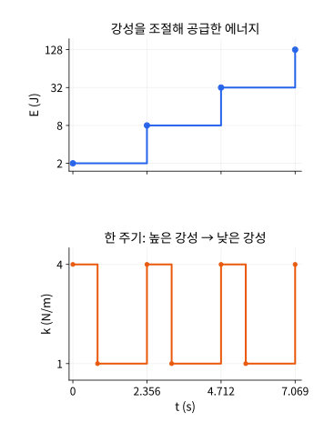
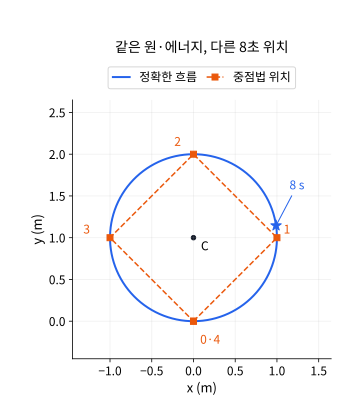

# 두 입자·속도 의존 힘: 후속 연구 확장 계산 기반

2026-11-12. 각운동량 두 단원을 `990a418`로 commit/push한 뒤 다음 두 단원의 심화 예제를 준비했다. 아래 유도·독립 Python 검산·그림은 **연구 확장의 계산 기반**이다. 기존 두 단원은 상수 강성의 정확한 흐름과 정확한 속도 회전을 사용한다. 새로운 시간 변조·수치 적분기를 기존 실습 기능으로 설명하지 않는다. 이 계산 기반을 준비한 당시에는 한영 학습 본문 통합과 최종 reader 검증 전이어서 고전역학 보강 집계를 **9/21단원**, 영역 대조를 **38영역·376주제**로 유지했다. 후속 통합 결과는 아래 기록을 따른다.

## 1. 양의 강성으로도 에너지를 공급할 수 있다

대상은 `isolated-central-pair-conservation`이다. 외부에서 상호작용의 강성을 조절하는 사고 실험으로, 계의 경계와 ‘에너지 보존’ 가정을 구분한다. 두 질량은 일정하고 외부의 합력·합토크는 0이다. 조절 장치는 입자 계의 바깥에 둔다.

### 매끄러운 변조의 일률

상대 위치 z=q1−q2, 상대 속도 w, 환산 질량 μ에서 F1=−k(t)z, F2=−F1이다. 힘은 여전히 반대 방향이며 중심력이므로 총 운동량 P와 각운동량 L은 보존된다. 그러나 퍼텐셜의 시간 의존성은 별도로 미분해야 한다.

$$
E=\frac{\lVert P\rVert^2}{2M}+\frac\mu2\lVert w\rVert^2
 +\frac{k(t)}2\lVert z\rVert^2,\qquad
\dot E=\frac{\dot k(t)}2\lVert z\rVert^2.
$$

운동에너지 변화와 퍼텐셜의 위치 미분은 상쇄하지만 시간 미분은 남는다. 조절 장치가 공급한 일 W를 포함해야 E(t)−E(0)=W가 된다. 공급 일의 단위는 J이며 힘의 시간 적분인 충격량과 다르다.

강성을 유한하게 순간 변경하는 이상화에서는 위치·속도가 연속이다. 힘에 유한한 점프가 생겨도 입자에 Dirac 충격량을 부여한 것은 아니다. 바뀐 퍼텐셜의 에너지 차이는 외부 매개변수의 일이다.

$$
\Delta W=\frac{k_{\rm after}-k_{\rm before}}2\lVert z\rVert^2.
$$

실제 장치의 유한 속도 조절은 매끄러운 식으로 다루어야 한다. 여기서는 스위치의 일을 포함한 정확한 이상화만 계산한다.

### 두 번의 사분 주기 이동을 합성하기

m1=m2=2 kg로 두면 μ=1 kg이다. 먼저 k=4 N/m, ω=2 s⁻¹에서 π/4 s, 다음 k=1 N/m, ω=1 s⁻¹에서 π/2 s 동안 움직이고 k=4로 되돌린다. 한 주기는 T=3π/4 s다. 각 구간은 정확한 조화 해의 사분 주기다.

$$
(z,w)\ \longmapsto\ (w/2,-2z)
\ \longmapsto\ (-2z,-w/2).
$$

성분별 주기 행렬의 고유값은 −2,−1/2이고 행렬식은 1이다. 지레팔과 속도의 외적은 유지되지만 위치 방향의 오차·진폭은 커질 수 있다. 모든 초기 상태가 커진다는 뜻은 아니다. z0=0인 축은 줄어들고, z0≠0인 성분에는 증폭이 있다. 이 선형 매개변수 불안정성을 혼돈으로 부르지 않는다.

고정된 질량 중심 R=0과 총 운동량 P=0을 택하면 입자 위치는 ±z/2, 속도는 ±w/2다. n주기 직후, 높은 강성으로 돌아온 시점에서는 다음이 정확하다.

$$
z_n=(-2)^n z_0,\quad w_n=(-1/2)^n w_0,\quad
L_n=\mu(z_n\times w_n)=L_0,\qquad
E_n=2\,4^n\lVert z_0\rVert^2+\frac{4^{-n}}2\lVert w_0\rVert^2.
$$

z0=(1,0) m,w0=0에서는 아래 표를 얻는다. 에너지 증가를 ‘보존법칙 실패’로 처리하지 않고 외부 조절의 일로 설명해야 한다.

| 주기 n | z_x (m) | E_n (J) | 누적 공급 일 (J) |
|---|---:|---:|---:|
| 0 | 1 | 2 | 0 |
| 1 | −2 | 8 | 6 |
| 2 | 4 | 32 | 30 |
| 3 | −8 | 128 | 126 |



그림은 이 표의 w0=0 사례다. 위는 J의 값을 밑 2 로그 눈금으로 표시하고 아래는 N/m이며 가로축만 시간을 공유한다. 각 구간의 에너지는 일정하고 높은 강성으로 복귀할 때 점프한다. 양의 강성을 사용한다는 사실만으로 시간에 걸친 일정 에너지나 진폭 상계를 얻지 못한다.

w0=(0,1) m/s로 바꾸면 L=1 kg m²/s인 회전 상태다. 처음 E=5/2 J, 한 주기 뒤 E=65/8 J이지만 L은 같다. 각운동량이 0인 특수 예제에만 의존하지 않는 반례다.

### 정확한 분수 검산

다음 코드는 삼각함수를 수치 적분하지 않고 사분 주기의 정확한 사상을 합성한다. 두 스위치의 일을 각각 계산한다. 표본 검산과 별도로 위 행렬식·주기 식이 일반 n에 대한 대수적 근거다. 모든 수치는 앞에서 선언한 SI 단위의 수치값이다.

```python
from fractions import Fraction as F

def dot(a, b):
    return sum(x*y for x, y in zip(a, b))

def cross(a, b):
    return a[0]*b[1]-a[1]*b[0]

def energy(z, w, k):
    return (dot(w, w)+k*dot(z, z))/2  # reduced mass = 1

def quarter(z, w, omega):
    return tuple(x/omega for x in w), tuple(-omega*x for x in z)

for initial_w in [(F(0), F(0)), (F(0), F(1))]:
    z, w = (F(1), F(0)), initial_w
    E0, L0, work = energy(z, w, F(4)), cross(z, w), F(0)
    print("initial relative velocity:", initial_w)
    for n in range(6):
        assert z == (F((-2)**n), F(0))
        assert w == tuple(x*F(-1, 2)**n for x in initial_w)
        assert cross(z, w) == L0
        assert energy(z, w, F(4))-E0 == work
        assert energy(z, w, F(4)) == 2*F(4)**n+dot(initial_w, initial_w)*F(1, 4)**n/2
        print(n, "E:", energy(z, w, F(4)), "L:", L0, "work:", work)
        if n == 5:
            break
        before = energy(z, w, F(4))
        z, w = quarter(z, w, F(2))
        assert energy(z, w, F(4)) == before
        work += (F(1)-4)*dot(z, z)/2
        before = energy(z, w, F(1))
        z, w = quarter(z, w, F(1))
        assert energy(z, w, F(1)) == before
        work += (F(4)-1)*dot(z, z)/2
```

현재 실습의 k는 한 실험 동안 일정하다. π/4와 π/2는 기존 0.1 s 입력 격자에 정확히 놓이지 않으므로 위 구간을 실습에서 그대로 실행할 수 있다고 안내하면 안 된다. 커진 상태가 기존 위치·속도 입력 범위를 벗어날 수도 있다. 이 확장은 독립 코드로 재현한다.

## 2. 에너지와 궤도 원을 보존해도 도착 시각은 틀릴 수 있다

대상은 `gyroscopic-force-energy-momentum`이다. 기존 정확한 해를 기준으로 별도의 암시적 중점법을 비교한다. J(vx,vy)=(−vy,vx), 일정 Ω에서 v'=ΩJv, q'=v다. 수치 시간 간격 h>0는 새 비교 코드의 매개변수이며 기존 실습에 추가된 조작이 아니다.

### 속도 사상과 회전각 유도

중점 속도 v_bar=(v_next+v)/2를 쓰면 Δv=hΩJ v_bar다. a=hΩ/2와 J²=−I를 이용해 선형식을 직접 푼다.

$$
v_{n+1}=R_hv_n,\qquad
R_h=\frac{(1-a^2)I+2aJ}{1+a^2},\qquad
q_{n+1}=q_n+\frac h2(v_n+v_{n+1}).
$$

회전 계수의 제곱합은 1이다. 또는 ΔK=m v_bar·Δv=0으로 에너지 보존을 직접 증명할 수 있다. 이 사상은 양의 h에서 정의되지만 정확한 회전각 Ωh와 수치 회전각은 다르다.

$$
\theta_h=2\arctan(h\Omega/2),\qquad
n\theta_h-\Omega nh
=-\frac{t\Omega^3h^2}{12}+O(t\Omega^5h^4),\quad t=nh.
$$

오른쪽 급수는 작은 |hΩ|에서 사용한다. 큰 간격의 반례는 급수로 근사하지 않고 정확한 θ_h로 계산한다. ‘모든 h에서 에너지 보존’과 ‘모든 h에서 정확’은 다른 주장이다.

### 유도 중심과 수정 각운동량까지 보존됨을 확인

Ω≠0에서 C=q+Jv/Ω이면 수치 갱신에서도 ΔC=h v_bar+J(hΩJv_bar)/Ω=0이다. 이 절의 L=m(q×v)는 한 입자의 실험실 원점에 대한 역학적 각운동량이다. 원래 단원의 수정 불변량 I와 다음 관계가 성립한다.

$$
I=L-\frac{m\Omega}{2}\lVert q\rVert^2
=\frac{m}{2\Omega}\lVert v\rVert^2-\frac{m\Omega}{2}\lVert C\rVert^2.
$$

따라서 K와 C의 보존은 I도 보존한다. 수치 위치는 정확한 해와 같은 중심·반지름의 원 위에 있지만 그 원 위의 시각별 점이 다를 수 있다. Ω=0에서는 중심 공식을 사용하지 않고 일정 속도 자유 운동을 정확히 갱신한다.

### h=2 s의 네 번 이동

m=1 kg,Ω=1 s⁻¹,q0=0,v0=(1,0) m/s에서 h=2 s이면 θ_h=π/2다. 네 단계 뒤 t=8 s의 수치 상태는 초기 상태로 돌아온다. 정확한 해는 q=(sin 8,1−cos 8) m다.

| 검사 | 중점법의 t=8 s | 정확한 흐름의 t=8 s |
|---|---|---|
| 위치 (m) | (0,0) | (sin 8,1−cos 8) |
| 운동에너지 (J) | 1/2 | 1/2 |
| 유도 중심 (m) | (0,1) | (0,1) |
| 수정 각운동량 (kg m²/s) | 0 | 0 |

위치 오차는 2|sin 4|≈**1.513604991 m**다. 에너지·유도 중심·수정 불변량·궤도 모양의 검사만으로 이 위상 오차를 찾을 수 없다. 시간별 관측을 포함해야 한다. Ω를 잘못 학습한 정확한 회전 모델도 에너지를 보존할 수 있으므로, 수치 오차와 힘 법칙의 오차 역시 따로 평가한다.



파랑은 정확한 연속 위치, 주황 네모는 중점법의 네 단계다. 주황 점선은 순서를 보여주는 직선 연결이며 중간 시간의 물리 궤적을 뜻하지 않는다. 별 표시는 정확한 t=8 s 위치다. 두 위치 축은 m이고 단위 길이가 같다.

### 부동소수점 보존 잔차 대신 유리수 검산

계수와 초기 상태가 유리수이면 중점 갱신도 유리수다. 아래 코드는 네 Ω·네 h의 16준비에서 각 100단계의 K,I,C를 분수로 확인한다. 삼각함수는 정확한 해의 위치 오차를 숫자로 보여줄 때만 사용한다. 유한한 준비 검사는 앞의 일반 내적·사상 증명을 대신하지 않는다.

```python
from fractions import Fraction as F
from math import sin, hypot

def dot(a, b):
    return sum(x*y for x, y in zip(a, b))

def J(v):
    return (-v[1], v[0])

def midpoint(q, v, omega, h):
    a = h*omega/2
    c, s = (1-a*a)/(1+a*a), 2*a/(1+a*a)
    vn = (c*v[0]-s*v[1], s*v[0]+c*v[1])
    return tuple(x+h*(u+w)/2 for x, u, w in zip(q, v, vn)), vn

def invariants(q, v, omega):
    K = dot(v, v)/2  # mass = 1
    I = q[0]*v[1]-q[1]*v[0]-omega*dot(q, q)/2
    C = None if omega == 0 else tuple(x+y/omega for x, y in zip(q, J(v)))
    return K, I, C

for omega in map(F, [0, 1, -1, "1/10"]):
    for h in map(F, ["1/10", "1/2", 2, 4]):
        q0, v0 = (F(1), F(2)), (F(3), F(-1))
        q, v = q0, v0
        expected = invariants(q, v, omega)
        for n in range(1, 101):
            q, v = midpoint(q, v, omega, h)
            assert invariants(q, v, omega) == expected
            if omega == 0:
                assert q == tuple(x+n*h*u for x, u in zip(q0, v0))
                assert v == v0
print("16 preparations x 100 exact-rational invariant checks passed")
q, v = (F(0), F(0)), (F(1), F(0))
for _ in range(4):
    q, v = midpoint(q, v, F(1), F(2))
assert q == (0, 0) and v == (1, 0)
assert invariants(q, v, F(1)) == (F(1, 2), F(0), (F(0), F(1)))
error = 2*abs(sin(4))
assert abs(error-hypot(sin(8), 2*sin(4)**2)) < 1e-14
print("four-step position error (m):", error)
```

## 자료 대조와 다음 통합

입자 계의 경계·총 운동량·각운동량 분해는 [Peraire·Widnall의 MIT 원 강의](https://ocw.mit.edu/courses/16-07-dynamics-fall-2009/5b68bc0342763cf099422af5a075940a_MIT16_07F09_Lec11.pdf)를 대조했다. 중점법의 정의와 기하적 적분 배경은 [Hairer의 Lecture 2](https://www.unige.ch/~hairer/poly_geoint/week2.pdf), 수정 흐름과 원래 흐름의 구분은 [Lecture 3](https://www.unige.ch/~hairer/poly_geoint/week3.pdf)을 참고했다. 위 스위칭 값·회전 사상·두 반례는 이 문서에서 직접 유도하고 별도로 검산한 예제다.

다음 통합에서는 기존 원고·연습을 보존하여 한영 설명·코드·수식과 그림을 연결한다. 상수 k/정확한 속도 회전이라는 기존 조작 계약도 보존한다. 새 본문의 KaTeX/GFM·한영 일치·원고 보호·실제 입력 대조, 정적 출력과 한영·명암·반응형 reader를 검증한 뒤에만 보강 단원 수를 올린다. 전체 51영역·509주제와 `curriculumComplete` 상태는 그대로 둔다.

### 이 계산 기반의 확인 결과

- 두 Python 블록을 표준 라이브러리만으로 실행했다. 첫 블록은 두 초기 상대 속도의 각 0~5주기에서 정확한 주기 사상·각운동량·구간 에너지·두 스위치의 일 수지를 확인했다. 둘째는 16준비×100단계의 유리수 불변량, 자유 운동 분기와 네 단계 반례를 확인했다.
- 실제 기존 `gyroscopicConservation([1,10,0,0,10,0,80])`의 위치 `(0.9893582466,1.1455000338)` m와 독립 해석식을 대조했다. 위치 오차는 1.5136049906158566 m이며 운동에너지는 0.5 J, 수정 불변량은 0이다. 유도 중심의 약 1e−16 반올림 오차는 정확한 유리수 중점 검산과 구별한다.
- 두 SVG를 PNG로 렌더하여 직접 확인했다. 에너지 그림의 로그 눈금, 시간·강성·에너지의 단위 분리, 위치 그림의 동일 축척·순서 표지·정확한 도착점·수치 점선의 의미를 확인했다. 기존 한영 학습 원고·등록·기능·배포 출력은 이 문서 준비 단계에서 변경하지 않았다.
- 두 코드 블록·두 표의 열 구조와 strict KaTeX 렌더를 확인했고, 상대 SVG 경로·XML·비유한 좌표 부재를 검사했다. 수식의 일반 유도와 유한 준비의 실행 검사를 구분한다.

## 후속 한영 학습 본문 통합 완료

두 단원의 기존 본문·연습을 보존하여 각 언어에 여섯 표시 수식·동일 Python·설명 SVG를 통합했다. 네 Python 실행·4파일 선택 테스트113개·타입·lint·콘텐츠·정적 빌드와 1,888개 HTML 출력 검사가 통과했다. 실제 reader는 39상태·6조작 그룹·6안내 실험에서 페이지 오류·Axe 위반 0개를 확인했다. 범위와 세부 결과는 [고전역학 검토 기록](classical-mechanics-topic-review.md)의 보존법칙 배치를 따른다. 고전역학은 11/21단원 보강이며 영역 전체와 후속 교육과정의 완료를 뜻하지 않는다.
