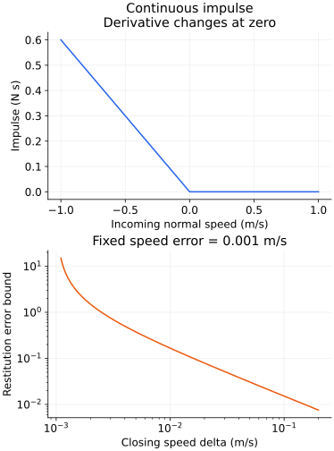
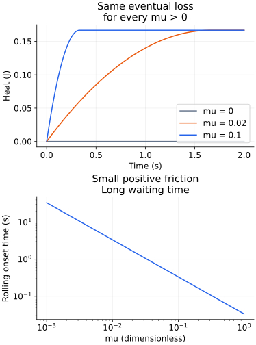

# 접촉 충격의 질량 계량과 작은 마찰의 극한

2026-11-12. 다음 `frictionless-rod-contact-impulse`·`driven-wheel-rolling-sliding`의 계산 기반이다. 기존 한영 원고·실제 입력·수치 구현을 대조한 뒤 사영·식별 안정성·극한 순서의 예제를 준비했다. 아래는 통합 전의 계산 준비 기록이다. 이후 두 단원 한영 본문·네 공개 그림에 통합하고 선택 테스트 125개·최종 reader 49상태·정적 출력을 검증했다. [통합 검증 범위](classical-mechanics-topic-review.md)에 따라 고전역학 19/21에 포함하며 영역 전체 완료 집계는 올리지 않는다. 기존 모델은 단일 마찰 없는 순간 충돌과 고정 높이 바퀴의 연속 운동을 구분한다.

## 1. 충돌을 질량 행렬이 정하는 거리에서 읽기

막대의 일반화 속도를 v=(Vx,Vy,ω)로, 질량 행렬을 M=diag(m,m,I)로 둔다. 여기서 m>0, a≥0, h>0, I=m(a²+h²)/3이다. 접촉 법선 Jacobian은 J=(0,1,a), 충돌 전 법선 속도는 c=Jv다. 기하를 순간적으로 고정하고 마찰 없는 단일 접촉만 고려한다.

$$
W=JM^{-1}J^{\mathsf T}>0,\qquad
n=\frac{M^{-1}J^{\mathsf T}}{W},\qquad Jn=1,\qquad
P=\operatorname{Id}-nJ.
$$

닫히는 접촉 c<0에서 완전 비탄성 법선 충돌 e=0의 결과는 Pv다. 이는 다음 문제의 유일한 해다.

$$
\min_{Jz\ge0}\frac12(z-v)^{\mathsf T}M(z-v).
$$

질량 행렬이 속도 변화의 비용을 정한다. 제약을 만족하는 어떤 후보도 z=Pv+t+αn, Jt=0, α≥0로 쓸 수 있다. Jn=1을 사용했고, t와 n은 M 내적에서 직교한다. 따라서

$$
\frac12\|z-v\|_M^2
=\frac12\|t\|_M^2+\frac{(\alpha-c)^2}{2W}
\ge\frac{c^2}{2W}\qquad(c<0).
$$

등호는 t=0,α=0일 때뿐이다. 반대로 c≥0이면 v 자체가 허용되어 목적함수 0으로 끝난다. 선형 P는 닫히는 가지의 경계면 사영이고, 실제 전체 비탄성 충돌 법칙은 허용 반공간으로의 조각별 사영이다. 분리 중인 속도에 P를 무조건 적용하지 않는다.

$$
P^2=P,\qquad P^{\mathsf T}M=MP,\qquad
R=2P-\operatorname{Id},\qquad R^2=\operatorname{Id},\qquad
R^{\mathsf T}MR=M.
$$

R은 질량 계량에서의 반사다. e=1인 닫히는 접촉에 해당하며 운동에너지를 보존한다. R²=Id는 행렬의 성질이다. 한 번 충돌한 뒤 이미 분리 중인 상태에 실제 물리 법칙을 다시 적용하면 충격은 0이므로, 이를 ‘같은 충돌을 두 번 하면 원래 속도’라고 설명하면 안 된다.

## 2. 반발계수는 한 성분에만 작용한다

v_T=Pv, v_N=nJv로 분해하면 두 성분은 M 내적에서 직교한다. 닫히는 가지에서

$$
v^+=v_T-e v_N,\qquad
K^+=K_T+e^2K_N,\qquad
K_N=\frac{c^2}{2W},\qquad
K^--K^+=(1-e^2)\frac{c^2}{2W}.
$$

접촉에 접하는 일반화 속도는 그대로 두고 질량 계량의 법선 성분만 반사·축소한다. 따라서 e=0이어도 전체 물체가 정지하는 것은 아니다. K_T에는 병진·회전이 함께 들어갈 수 있다. 질량 계량의 법선은 좌표 벡터 (0,1,0)와 다르므로 COM 수직 속도만 뒤집는 규칙은 일반적으로 틀린다.

실제 입력 `[1,2,2,0,-10,0,5]`에서는 m=a=h=1, I=2/3, W=5/2, c=−1, e=1/2다. 충격은 3/5 N s, 충돌 후 Vy=−2/5 m/s, ω=9/10 rad/s, 접촉 법선 속도=1/2 m/s다. 에너지는 1/2 J에서 7/20 J로 바뀌어 3/20 J를 잃는다. COM이 계속 내려가도 접촉점은 올라갈 수 있다.

## 3. 접선에 가까운 충돌: 상태 갱신과 매개변수 추정의 차이

고정된 기하·e에서 실제 법선 충격은

$$
j(c)=-\frac{1+e}{W}\min(c,0)
$$

이다. c=0에서 연속이고 Lipschitz 상수 (1+e)/W가 유한하다. 하지만 왼쪽 미분은 −(1+e)/W, 오른쪽 미분은 0이다. 자동미분으로 하나의 매끄러운 가지를 경계 양쪽에 연장하면 접촉 활성화의 미분 변화를 놓친다.

추정 문제는 다르다. 실제 닫힘 속도를 δ=−c⁻>0, 실제 열림 속도를 c⁺=eδ라 하자. 두 속도의 측정 오차 d₋,d₊가 각각 |d|≤ζ이면, 잡음이 있는 비율 추정량은

$$
\widehat e=\frac{e\delta+d_+}{\delta-d_-},\qquad
|\widehat e-e|\le\frac{\zeta(1+e)}{\delta-\zeta}
\quad(0\le\zeta<\delta).
$$

작은 충격이 매끄럽게 0에 가는 것과 반발계수를 안정적으로 알아내는 것은 별개다. e=1/2,ζ=0.001 m/s이면 δ=0.1에서 상계는 1/66, δ=0.01에서 1/6이다. δ≤ζ이면 이 비율 상계는 사용할 수 없고 접촉의 닫힘 여부도 오차 구간에서 바뀔 수 있다. 사전 제약 0≤e≤1을 넣어 추정을 제한할 수는 있지만 자료가 식별 정보를 준다는 뜻은 아니다.

실제 입력 `[1,2,2,0,-11,10,5]`는 c⁻=−1/10, 충격 3/50, c⁺=1/20, 손실 3/2000이다. `[1,2,2,0,-10,10,5]`는 정확히 c⁻=0이라 충격이 없다. δ=0.01·0.001과 연속 오차 가족은 기존 입력보다 세밀한 **별도 해석 예제**다.



위는 m=a=h=1,e=1/2의 법선 속도→충격이다. 아래는 ζ=0.001 m/s에서 δ>ζ인 반발계수 오차 상계다. 두 패널은 다른 종축을 사용한다. 아래 그림이 발산한다고 실제 충격 갱신도 발산하는 것은 아니다.

## 4. 구동이 없는 바퀴를 두 에너지 모드로 나누기

이제 충돌이 아니라 고정 높이에서의 연속 접촉을 본다. I=κmR²,0<κ≤1, 시계방향 각속도 Ω, 상대 미끄럼 u=V−RΩ로 둔다. 중력가속도는 기존 모델의 g=10 m/s², 수평 외력 F와 구동 토크 τ는 모두 0이다. 법선 하중은 mg이고 순수 굴림의 정지마찰 요구량은 0이다. μs≥μk≥0을 유지한다.

$$
m\dot V=f,\qquad I\dot\Omega=-Rf,\qquad
\Pi=mV+\frac{I}{R}\Omega=\text{constant}.
$$

이를 공통 굴림 속도와 유효 미끄럼 질량으로 바꾸면

$$
v_r=\frac{V+\kappa R\Omega}{1+\kappa},\qquad
m_{\rm eff}=\frac{m\kappa}{1+\kappa},\qquad
V=v_r+\frac{\kappa}{1+\kappa}u,\qquad
R\Omega=v_r-\frac{1}{1+\kappa}u.
$$

직접 전개하면 교차항이 사라져

$$
K=\frac12m(1+\kappa)v_r^2+\frac12m_{\rm eff}u^2
$$

이다. 마찰은 첫 에너지 모드를 바꾸지 않고 상대 미끄럼 에너지를 소모한다. ‘마찰은 항상 COM을 감속한다’는 해석은 틀린다. 초기 회전이 빠른 경우에는 COM을 가속하면서도 두 번째 모드의 에너지를 줄일 수 있다.

u₀≠0,μk>0에서 운동마찰 f=−μkmg sign(u)이므로

$$
u(t)=\operatorname{sign}(u_0)
\max\left(|u_0|-\frac{\mu_kmg}{m_{\rm eff}}t,0\right),\quad
t_* =\frac{m_{\rm eff}|u_0|}{\mu_kmg},\qquad
Q(t)=\frac12m_{\rm eff}(u_0^2-u(t)^2).
$$

0에 도달하면 필요한 정지마찰도 0이라 그 뒤에는 일정한 속도로 구른다. 이 결과는 F=τ=0인 특수 가족이다. 구동·토크가 있거나 굴림 요구 마찰이 정지 한계를 넘는 일반 가족에 그대로 대입하지 않는다.

## 5. 최종 손실은 같아도 기다리는 시간은 달라진다

m=R=1,κ=1/2,V₀=1,Ω₀=0이면 v_r=2/3, m_eff=1/3, 초기 에너지 1/2 J다. 모든 μk>0에서 최종 속도 V=RΩ=2/3, 최종 에너지 1/3 J, 손실 1/6 J다. 그러나 t_*=1/(30μk) s다.

| μk | 굴림 도달 시간 (s) | t=1 s의 V, Ω | t=1 s의 Q (J) |
|---|---|---|---:|
| 0 | 미래 도달 없음 | 1, 0 | 0 |
| 1/10 | 1/3 | 2/3, 2/3 | 1/6 |
| 1/5 | 1/6 | 2/3, 2/3 | 1/6 |
| 1/2 | 1/15 | 2/3, 2/3 | 1/6 |

실제 입력은 `[1,2,10μk,0,5,0,0,10,0,10]`이다. μk=1/10에서 조회 시간 코드를 3과 4로 바꾸면 각각 t=0.3,0.4 s로 사건을 사이에 둔다. 전자는 u=1/10,Q=33/200, 후자는 u=0,Q=1/6이다.

임의로 작은 양의 마찰까지 허용하는 연속 해석 가족에서는

$$
\lim_{\mu_k\downarrow0}\lim_{t\to\infty}Q(t,\mu_k)
=\frac12m_{\rm eff}u_0^2,\qquad
\lim_{t\to\infty}\lim_{\mu_k\downarrow0}Q(t,\mu_k)=0.
$$

극한의 순서가 바뀌면 답도 바뀐다. 유한한 실험 시간에서 손실이 작다는 관측으로 장시간의 최종 손실도 작다고 결론 내릴 수 없다. μk=0이면 처음부터 미끄럼이 유지되고 열은 생기지 않는다. 그림의 μk=0.02처럼 기존 0.1 간격 입력 밖의 값과 임의로 긴 시간은 별도 해석 가족이다.



첫 패널은 0≤t≤2 s의 열, 둘째는 μk>0의 도달 시간이다. μ=0의 열 곡선은 0에 남는다. 마찰이 0으로 작아지면 열 곡선은 유한 시간 구간마다 0으로 접근하지만 도달 시간은 무한히 길어진다.

## 6. 검산과 후속 통합

```bash
python3 scripts/learning/verify-contact-research.py
python3 scripts/learning/verify-contact-research.py --figures
npx tsx --test scripts/learning-rigid-contact.test.ts scripts/learning-contact-research.test.ts
```

Python 기본 검사는 표준 라이브러리의 정확한 분수로 27기하의 사영·반사 행렬, 324개 반발 상태, 속도 오차 경계와 1,080개 자유 바퀴 에너지 모드·수지를 확인한다. 그림 옵션에는 NumPy·Matplotlib가 필요하다. 이는 원래 일반 모델의 전체 입력 검증을 대체하지 않는다.

일반 질량 행렬·접촉 Jacobian 배경은 [MIT Underactuated Robotics의 다물체 접촉](https://underactuated.mit.edu/multibody.html), 굴림 배경은 [MIT8.01SC 회전과 병진](https://ocw.mit.edu/courses/8-01sc-classical-mechanics-fall-2016/pages/week-12-rotations-and-translation-rolling/)을 따른다. 위의 사영 논증·조건수 상계·모드 분해·극한 순서는 여기서 직접 유도한 특수 예제다. 원자료 그림은 복제하지 않았다.

다음은 기존 한영 원고·연습을 보존한 본문 통합, 공개 그림의 현지화, 실제 입력·독립 참조와 최종 reader·접근성·정적 출력 검증이다. 그 뒤 초기값 민감도·비유일성을 순서대로 진행한다. 전체 51영역·509주제의 범위를 유지한다.

준비 검증: 기존 rod 900건·wheel 1,000건·독립 사건 ODE 180건과 새 인용 입력·grazing 경계·굴림 도달 시간·사건 전후·COM 가속 예제를 포함한 **2파일·선택 테스트 34개**가 통과했다. 실제 reader 통합은 다음 단계다.

## 후속 통합 완료

기존 한영 본문과 연습을 보존해 위 계산을 통합했다. 무구동 열의 유한 구간 균등 상계, 실제 회전 바퀴의 COM 가속, 측정 사전 제약과 식별 정보의 구분을 보강했다. 공개 자산은 `public/assets/learning/classical-contact-grazing.{en,ko}.svg` 및 `classical-contact-friction-limit.{en,ko}.svg`다. 위 준비 단계의 34개 검사와 구분해 최종 선택 테스트는 125개다. 전체 CI·공개 배포 결과는 별도 확인한다. 다음은 [초기 상태의 계산 준비](initial-state-research-foundation.md)다.
