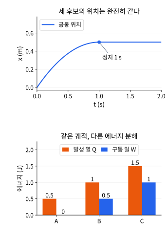
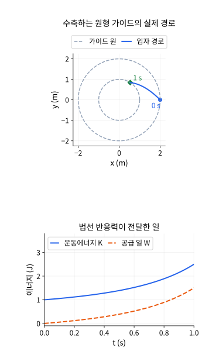

# 마찰 식별과 움직이는 구속: 후속 연구 확장 계산 기반

2026-11-12. 보존법칙 두 단원의 한영 통합 검증과 병행하여 다음 `dry-friction-stopping-release`·`circular-guide-reaction-work`의 계산 기반을 준비했다. 아래는 새 심화 내용을 위한 유도·독립 검산으로 준비 당시에는 한영 학습 본문 통합 전이었다. 후속 통합 결과는 아래 기록을 따른다. 기존 실습은 알려진 입력의 Coulomb 마찰과 **고정** 원형 가이드다. 계산 기반 준비만으로 보강 단원·원주제 완료 집계를 올리지 않았다.

## 1. 같은 전체 위치 이력이 마찰 계수를 식별하지 못하는 경우

질량·법선 하중이 알려져 있어도, 구동력 F가 별도로 교정되지 않고 위치만 관측하면 운동마찰력의 크기 C=μk N과 F를 구분하지 못할 수 있다. 원래 실습에서는 F와 계수를 입력으로 알고 있다. 아래 역문제는 그 입력 일부를 관측자에게 감춘 별도 문제다.

### 같은 방향의 가속도는 두 힘의 차이다

양의 속도 구간에서 ma_plus=F−C다. m=1 kg,g=10 m/s²,N=10 N에서 세 후보를 선택한다. 정지 마찰 한계 S=μs N는 모두 3 N이다. 기존 실습이 허용하는 μs≥μk와 정지 시 |F|≤S의 고착 규약을 사용한다.

| 후보 | F (N) | C (N) | μk | μs | 실제 입력 코드 (m,k,margin,F,v,t) |
|---|---:|---:|---:|---:|---|
| A | 0 | 1 | 0.1 | 0.3 | (1,1,2,0,10,10) |
| B | 1 | 2 | 0.2 | 0.3 | (1,2,1,10,10,10) |
| C | 2 | 3 | 0.3 | 0.3 | (1,3,0,20,10,10) |

여기서 k는 계수의 정수 코드이며 용수철 강성이 아니다. margin은 μs−μk의 0.1 단위 코드다. 세 후보의 양의 초기 속도는 v0=1 m/s이며 가속도는 모두 −1 m/s²다. 정확한 연속 시간 해는 세 후보에 대해 동일하다.

$$
x(t)=\begin{cases}t-t^2/2,&0\le t\le1,\\1/2,&t\ge1,\end{cases}
\qquad
v(t)=\begin{cases}1-t,&0\le t<1,\\0,&t\ge1.\end{cases}
$$

세 경우 모두 1초에 x=1/2 m에서 멈추고 이후 고착한다. 무한히 촘촘하고 오차 없는 위치 이력까지 관측해도 이 후보들을 구분하지 못한다. 단지 관측 시각이 부족한 문제가 아니다. 같은 방향의 가속도 관측은 (F,C)의 (1,1) 방향 변화에 불변이다.

### 에너지 수지의 분해도 추가 관측 없이 정해지지 않는다

세 후보의 초기 운동에너지는 1/2 J, 최종은 0이다. 전진 거리 1/2 m에서 Q=C/2,W=F/2이므로 다음과 같다.

| 후보 | 발생 열 Q (J) | 구동 일 W (J) | ΔK+Q−W (J) |
|---|---:|---:|---:|
| A | 1/2 | 0 | 0 |
| B | 1 | 1/2 | 0 |
| C | 3/2 | 1 | 0 |

같은 궤적에서 열과 외부 일이 서로 다르지만 모든 수지가 맞는다. 독립 열·힘 측정 없이 에너지 잔차를 0으로 만드는 것만으로 F,C를 식별할 수 없다. F가 독립적으로 알려지면 C=F−ma_plus로 구분되므로, 무엇을 알고 관측하는지 먼저 명시해야 한다.



위는 공통 위치 한 개를 그렸으며 세 개의 구별되는 궤적을 뜻하지 않는다. 아래는 멈춘 뒤의 열과 구동 일이다. 위치 m와 에너지 J는 서로 다른 축을 사용한다.

### 반대 방향의 초기 속도로 두 번째 실험하기

같은 F,C,m을 유지한 채 v0=−1 m/s로 준비하면 ma_minus=F+C다. 두 실험의 **미끄러지는 구간**의 가속도로 다음을 복원한다.

$$
F=\frac m2(a_{\mathrm{plus}}+a_{\mathrm{minus}}),\qquad
C=\frac m2(a_{\mathrm{minus}}-a_{\mathrm{plus}}),\qquad
\mu_k=\frac C{mg}.
$$

가속도는 각각 (−1,1),(−1,3),(−1,5) m/s²다. 음의 초기 속도 실험의 정지 시각은 1,1/3,1/5초이고 정지 위치는 −1/2,−1/6,−1/10 m여서 구별된다. 정지 후의 0 가속도를 이 공식의 미끄럼 가속도로 대입하면 안 된다.

이 복원은 두 실험 사이에 힘·계수·하중이 유지된다는 가정에 의존한다. μs까지 정확히 정하는 것은 아니다. 관측한 고착은 정지 한계에 대한 하한을 주며, 실험 범위 밖의 방출 문턱을 추가로 관측해야 한다.

### 유리수 분기 검산

코드는 이 세 후보 가족의 해만 계산한다. 일반 접촉 해석기로 확장했다고 설명하지 않는다. min(t,stop)는 멈춘 뒤 고착하는 선언한 사례에서만 사용한다.

```python
from fractions import Fraction as F

def case(drive, direction, time):
    C = drive+1
    assert drive in (0, 1, 2) and direction in (-1, 1)
    a = drive-direction*C
    stop = -F(direction)/a
    u = min(time, stop)
    x = direction*u+a*u*u/2
    v = direction+a*u
    Q, W = C*abs(x), drive*x
    assert v*v/2-F(1, 2)+Q == W
    return x, v, stop, Q, W

for drive in map(F, [0, 1, 2]):
    ap, am = drive-(drive+1), drive+(drive+1)
    assert (ap+am)/2 == drive
    assert (am-ap)/2 == drive+1
    for direction in [-1, 1]:
        for time in map(F, [0, "1/10", "1/2", 1, 2, 10]):
            x, v, stop, Q, W = case(drive, direction, time)
            if direction == 1:
                u = min(time, F(1))
                assert x == u-u*u/2 and stop == 1
            else:
                assert stop == 1/(2*drive+1)
        print("drive, direction, stop, x, heat, work:",
              drive, direction, stop, x, Q, W)
```

## 2. 이상적 반응력의 영 가상 일과 실제 영 일률은 다르다

원래 원형 가이드는 중심·반지름이 고정되고 입자 속도가 접선이므로 반응력의 일이 0이다. 이제 중심은 고정하되 반지름 R(t)>0를 외부 장치가 지정하는 **다른 구속**을 생각한다. 마찰·접선 구동은 없고 양방향 가이드의 반응력만 입자에 작용한다. 단순히 관측 좌표나 기준점을 바꾼 것이 아니라 물리적 가이드가 움직인다.

### 시간 의존 구속을 먼저 미분하기

$$
g(q,t)=\frac12(\lVert q\rVert^2-R(t)^2)=0,\qquad
q\cdot v=R\dot R,\qquad
v=\dot R e_r+R\omega e_\theta.
$$

같은 시각에서 허용되는 가상 변위는 q·δq=0이다. 하지만 실제 속도는 R'≠0일 때 접선만이 아니다. 고정 가이드의 q·v=0을 가져오면 호환 조건부터 잘못된다.

기저를 미분하면 가속도와 뉴턴 식은 다음과 같다.

$$
a=(\ddot R-R\omega^2)e_r+(2\dot R\omega+R\dot\omega)e_\theta,
\qquad
N_{\mathrm{rad}}=m(\ddot R-R\omega^2),\qquad
\ell=mR^2\omega=\mathrm{constant}.
$$

반응력은 Nrad er이며 Nrad는 바깥 방향을 양수로 한 성분이다. 외부 접선 힘·토크가 없어서 ℓ는 보존된다. 원래 고정 반지름의 각가속도 식을 그대로 사용할 수는 없다.

### 가상 일과 실제 에너지 전달 구분하기

Fguide=λ∇q g에서 λ=Nrad/R이다. 같은 시각의 가상 변위에 대한 반응력의 일은 0이지만 실제 속도에 대한 일률은 다음과 같다.

$$
F_{\mathrm{guide}}\cdot\delta q=0,\qquad
P_{\mathrm{guide}}=-\lambda\partial_tg=N_{\mathrm{rad}}\dot R
=\frac d{dt}\left(\frac m2\dot R^2+\frac{\ell^2}{2mR^2}\right).
$$

가이드의 법선 속도는 u_g=R' er다. 반응력은 상대 속도 v−u_g와 직교하지만 실험실 속도 v와는 일반적으로 직교하지 않는다. 이 일률은 외부 구동 장치의 에너지 전달이며 마찰열이 아니다. 고정 R에서 R'=0을 넣으면 원래 영 일률 결과를 회복한다.

### 선형 수축의 정확한 예제

0≤t≤1 s에서 m=1 kg,ℓ=2 kg m²/s,R(t)=2 m−(1 m/s)t로 둔다. 초기 반지름 방향 속도는 이미 −1 m/s다. 정지해 있던 가이드나 입자를 순간 포획하는 문제로 해석하지 않는다. 구간 양끝의 시작·정지 충격을 추가로 선언하지도 않는다.

일반적인 선형 반지름 R=R0−b t에서는 b의 단위가 m/s이며 각도와 외부 일이 다음과 같다.

$$
\theta(t)-\theta_0=\frac{\ell t}{mR_0R(t)},\quad
N_{\mathrm{rad}}=-\frac{\ell^2}{mR(t)^3},\quad
W_{\mathrm{guide}}=\frac{\ell^2}{2m}\left(\frac1{R(t)^2}-\frac1{R_0^2}\right).
$$

각도 식은 b로 나누지 않아 b=0인 고정 반지름에서도 사용할 수 있다. 일은 반응력의 일률을 직접 적분한 것이며 에너지 잔차를 채우도록 정의한 값이 아니다. 수축에서는 안쪽 반응력과 안쪽 법선 속도의 내적이 양수다.

| t (s) | R (m) | K (J) | 공급 일 (J) |
|---|---:|---:|---:|
| 0 | 2 | 1 | 0 |
| 1/2 | 3/2 | 25/18 | 7/18 |
| 1 | 1 | 5/2 | 3/2 |



공간 그림은 동일 축척의 위치 좌표이며 점선 원은 초기·최종 가이드다. 아래는 운동에너지와 누적 공급 일의 시간 변화다. 힘·속도 벡터를 길이 축에 임의 배율로 겹치지 않는다. 반대로 b=−1 m/s로 팽창하면 1초 동안 W=−5/18 J로 가이드가 에너지를 회수한다. 마찰이 없어도 입자 역학적 에너지가 줄 수 있다.

### 유리수로 수축·팽창·고정 한계 확인하기

```python
from fractions import Fraction as F

def state(b, t):
    m, R0, ell = F(1), F(2), F(2)
    R, rd = R0-b*t, -b
    if not (0 <= t <= 1) or R <= 0:
        raise ValueError("Use the stated interval with positive radius")
    omega = ell/(m*R*R)
    alpha = 2*b*ell/(m*R**3)
    reaction = -ell*ell/(m*R**3)
    power = reaction*rd
    theta = ell*t/(m*R0*R)
    K = m*rd*rd/2+ell*ell/(2*m*R*R)
    K0 = m*b*b/2+ell*ell/(2*m*R0*R0)
    W = ell*ell/(2*m)*(1/(R*R)-1/(R0*R0))
    assert m*R*R*omega == ell
    assert 2*rd*omega+R*alpha == 0
    assert power == b*ell*ell/(m*R**3)
    assert K-K0 == W
    # g_t = -R*R_dot and lambda = reaction/R.
    assert -(reaction/R)*(-R*rd) == power
    return R, theta, omega, reaction, K, W

for b in map(F, [-1, 0, "1/10", 1]):
    for t in map(F, [0, "1/4", "1/2", "3/4", 1]):
        result = state(b, t)
    print("contraction rate b, final R, theta, omega, reaction, K, work:", b, *result)
assert state(F(1), F(1))[-2:] == (F(5, 2), F(3, 2))
assert state(F(-1), F(1))[-1] == F(-5, 18)
assert state(F(0), F(1)) == (F(2), F(1, 2), F(1, 2), F(-1, 2), F(1, 2), F(0))
try:
    state(F(2), F(1))
except ValueError:
    pass
else:
    raise AssertionError("A zero radius must be rejected")
```

현재 가이드 실습은 R을 한 실행 동안 고정한다. 반지름 입력을 실행 사이에 바꾸는 것만으로 위의 물리적 이동·외부 일·초기 반지름 속도가 구현되지는 않는다. 독립 확장 코드와 구분한다. 고정 한계 b=0,m=1,R=2,ω0=1/2,t=1은 실제 코드 `(1,4,0,0,5,10)`으로 대조할 수 있다.

## 근거와 확인 범위

마찰의 정지/미끄럼 법칙은 [MIT OCW 8.01, Chapter 8의 8.3.2](https://ocw.mit.edu/courses/8-01sc-classical-mechanics-fall-2016/mit8_01scs22_chapter8.pdf), 시간에 의존하는 구속 좌표의 배경은 [Sussman·Wisdom, SICM 1.6.2·연습 1.32](https://mitp-content-server.mit.edu/books/content/sectbyfn/books_pres_0/9579/sicm_edition_2.zip/chapter001.html)를 대조했다. 세 후보·식별 공식·움직이는 원의 반응력/일 예제는 이 문서에서 직접 유도했다.

- 독립 분수 식과 실제 마찰 모델의 36질의에서 위치·속도·가속도·마찰·에너지·열·일·정지 사건을 대조했다. 세 전진 준비의 전체 출력 위치/속도 곡선도 동일했다. 연속 시간의 동일성은 본문의 조각별 식으로 증명하며 표본 일치만으로 주장하지 않는다.
- 움직이는 가이드는 네 b값×다섯 시각의 20준비에서 각운동량·접선 방정식·법선 일률·승수 일률·에너지 수지를 분수로 확인했다. 기존 고정 가이드의 위 입력에서 R=2,ω=1/2,Nrad=−1/2,K=1/2,ℓ=2,Wguide=0을 대조했다. 수치 카르테시안 적분·새 Worker·새 조작형 모델을 검증했다는 뜻은 아니다.
- 다음은 기존 원고·연습을 보존한 한영 집필과 그림·실행 예제 통합이다. 실제 학습 화면·보존 검사·정적 빌드·출력 검증을 마친 뒤에만 보강 완료로 센다. 전체 51영역·509주제·남은 영역의 범위를 유지한다.
- 두 SVG 원본을 PNG로 렌더하여 직접 검토했다. 두 코드 실행·strict KaTeX·세 표의 6/4/4열 구조, 상대 이미지 경로·유한한 SVG XML도 확인했다.

## 후속 한영 학습 본문 통합 완료

두 단원의 원문·연습을 보존하여 한영 심화 설명·각 여섯 표시 수식·동일 Python·공개 SVG 네 개를 통합했다. 마찰 단원에는 인증된 가속도 오차의 힘/계수 상계와 분수 모서리 검산을 추가했다. 선택 113테스트와 교정 후 원고/보존 11재검사, 타입·lint·콘텐츠·최종 빌드·1,888 HTML 출력 검사가 통과했다. 실제 reader는 최종 42상태·6조작 그룹·6안내 실험에서 페이지 오류·Axe 위반 0개를 확인했다. [고전역학 검토 기록](classical-mechanics-topic-review.md)의 범위를 따르며 고전역학은 13/21단원 보강, 나머지는 8단원이다.
