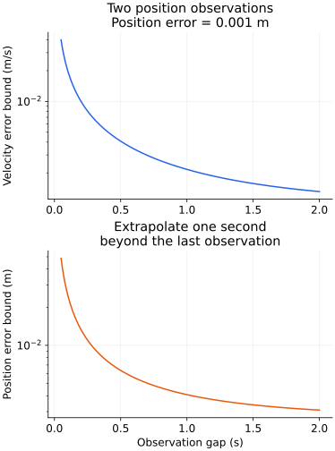
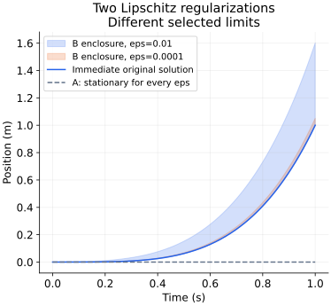

# 두 위치 관측의 복원 오차와 정규화에 의한 해 선택

2026-11-12. `inverted-spring-initial-state-sensitivity`·`nonlipschitz-newton-delayed-release`의 다음 계산 기반이다. 기존 한영 본문·실제 입력·독립 참조를 읽고, 상태의 관측 가능성과 비유일한 방정식의 정규화 선택을 확장했다. 아래는 통합 전의 계산 준비 기록이다. 이후 두 단원의 한영 본문·네 공개 그림에 통합하고 고전역학 21단원·10개 원주제 종합 대조를 마쳤다. [최종 근거와 적용 범위](classical-mechanics-domain-audit.md)를 따른다. 관측 오차·동역학의 불안정성·원래 법칙의 비유일성을 구분한다.

## 1. 두 위치로 초기 속도를 정할 수 있는 조건

힘 법칙 m x''=kx, m>0,k≥0가 정확히 알려져 있다고 하자. k>0에서 λ=√(k/m)>0이며 단위는 s⁻¹이다. 시간 0과 Δ>0의 위치를 알면

$$
\begin{pmatrix}x(0)\\x(\Delta)\end{pmatrix}
=\begin{pmatrix}1&0\\\cosh(\lambda\Delta)&\sinh(\lambda\Delta)/\lambda\end{pmatrix}
\begin{pmatrix}x_0\\v_0\end{pmatrix},\qquad
v_0=\lambda\frac{x(\Delta)-x_0\cosh(\lambda\Delta)}{\sinh(\lambda\Delta)}.
$$

관측 행렬의 행렬식은 sinh(λΔ)/λ>0이다. 같은 시각의 사진 하나와 달리 서로 다른 두 시각의 정확한 위치로 초기 속도까지 정할 수 있다. Δ=0이면 두 행이 같아져 속도를 알 수 없다. λ=0의 자유 입자에서는 행렬식이 Δ이고 v₀=(x(Δ)−x₀)/Δ다. 아래 식을 λ로 나누는 방식으로 0에 그대로 대입하지 않는다.

이 결론은 λ와 측정 시각을 안다는 조건이다. 미지의 힘 법칙·시간 오차·관측 편향까지 두 숫자만으로 복원했다는 주장이 아니다. 서로 다른 물리 단위의 행렬 성분에 임의의 수치 조건수를 붙이지 않고, 다음처럼 실제 단위의 오차를 전달한다.

## 2. 정확한 가역성과 오차에 대한 신뢰성은 다르다

위치 관측 y₀=x₀+d₀,yΔ=x(Δ)+dΔ에서 각각 |d|≤ε m라고 하자. 역산식의 삼각 부등식으로

$$
|\widehat v_0-v_0|\le
\lambda\epsilon\frac{1+\cosh(\lambda\Delta)}{\sinh(\lambda\Delta)}
=\lambda\epsilon\coth(\lambda\Delta/2).
$$

두 오차가 반대 부호일 때 등호가 가능하므로 주어진 독립 구간에서 날카로운 상계다. 짧은 간격에서는 약 2ε/Δ로 커진다. 위치가 거의 같은 시간에 찍힌 사진 두 장은 잡음 있는 차분으로 속도를 추정하는 어려움을 갖는다. λ=0에서는 상계가 정확히 2ε/Δ다.

두 위치로 임의 시각 t의 위치를 직접 쓰면

$$
\widehat x(t)=
\frac{\sinh(\lambda(\Delta-t))}{\sinh(\lambda\Delta)}y_0+
\frac{\sinh(\lambda t)}{\sinh(\lambda\Delta)}y_\Delta.
$$

0≤t≤Δ에서는 두 계수가 음이 아니고 합은 cosh(λ(t−Δ/2))/cosh(λΔ/2)≤1이다. 따라서 보간 위치의 오차는 ε 이하이며 중간에서는 ε/cosh(λΔ/2)다. 반면 t≥Δ의 외삽에서는

$$
|\widehat x(t)-x(t)|\le
\epsilon\frac{\sinh(\lambda(t-\Delta))+\sinh(\lambda t)}{\sinh(\lambda\Delta)}
=\epsilon\frac{\sinh(\lambda(t-\Delta/2))}{\sinh(\lambda\Delta/2)}.
$$

가 된다. 같은 두 관측이라도 보간과 외삽의 신뢰성은 다르다. λ=0의 일반식은 x̂(t)=(1−t/Δ)y₀+(t/Δ)yΔ, 오차 상계 ε(|1−t/Δ|+|t/Δ|)다. 두 관측을 정확히 통과하는 잔차 0만으로 미래 예측을 인증할 수 없다.

λ=1 s⁻¹,ε=0.001 m의 예는 다음과 같다. 마지막 열은 마지막 관측으로부터 1초 뒤를 예측한다.

| 간격 Δ (s) | 초기 속도 오차 상계 (m/s) | t=Δ+1 s의 위치 오차 상계 (m) |
|---|---:|---:|
| 0.1 | 0.020016664 | 0.025066688 |
| 1 | 0.002163953 | 0.004086161 |
| 2 | 0.001313035 | 0.003086161 |



실제 실습 입력 `[1,1,10,-10,10,10,10]`은 초기 위치가 1로 같고 속도가 −1,+1인 두 운동을 t=1 s에 비교한다. 위치는 e⁻¹,e여서 두 번째 사진이 두 속도를 구별한다. 시간 코드를 20으로 바꾸면 t=2 s의 비교다. 실습에 위치 측정·역산 입력이 추가된 것은 아니며 위의 잡음 구간은 별도 Python 관측 예제다.

## 3. 같은 비유일한 힘 법칙으로 수렴하는 두 유일한 모델

이제 다른 문제인 x''=12c√(max(x,0)), c>0, x(0)=x'(0)=0을 본다. 원래 법칙에는 정지 해와 모든 대기시간 τ≥0의 xτ=c²max(t−τ,0)⁴가 있다. 다음 두 정규화의 ε는 √길이 단위를 갖는다.

$$
a_\epsilon^A(x)=12c\left(\sqrt{\max(x,0)+\epsilon^2}-\epsilon\right),\qquad
a_\epsilon^B(x)=12c\sqrt{\max(x,0)+\epsilon^2}.
$$

각 ε>0에서 두 가속도는 전역 Lipschitz이며 x에 대한 기울기 상수는 6c/ε 이하로 잡을 수 있다. max 때문에 0에서 미분이 꺾일 수 있으므로 여기서 이들을 모든 점에서 매끄럽다고 부르지 않는다. 각 방정식의 초기값 해는 유일하지만, ε→0에서 그 Lipschitz 상수는 균등하지 않다.

$$
\sup_{x\in\mathbb R}|a_\epsilon^{A,B}(x)-12c\sqrt{\max(x,0)}|
\le12c\epsilon.
$$

두 힘은 같은 m을 곱해 얻으며 힘 오차는 12mcε 이하이다. A는 aεᴬ(0)=0이므로 유일한 해가 모든 시간 정지다. B는 aεᴮ(0)=12cε>0이어서 양의 위치로 움직인다. ε>0의 두 모델은 원래 방정식과 다른 문제이며, 임의의 정규화를 추가했다고 원래 문제의 해 선택이 정당화되지는 않는다.

## 4. B가 즉시 출발 해를 선택한다는 것을 증명하기

B의 운동은 t>0에서 x>0,v>0이다. 가속도에 x'를 곱해 적분하면

$$
(x')^2=16c\left[(x+\epsilon^2)^{3/2}-\epsilon^3\right],\qquad
t_\epsilon(x)=\int_0^x
\frac{dz}{4\sqrt c\sqrt{(z+\epsilon^2)^{3/2}-\epsilon^3}}.
$$

ε=0인 즉시 출발 가지의 역시간은 t₀(x)=x¹ᐟ⁴/√c다. 비교에는 z=r⁴ 치환을 쓴다. a=√(r⁴+ε²)라고 두고 a³−ε³를 인수분해하면

$$
t_\epsilon(x)=\frac1{\sqrt c}\int_0^{x^{1/4}}g_\epsilon(r)\,dr,\qquad
g_\epsilon(r)=r\sqrt{\frac{a+\epsilon}{a^2+a\epsilon+\epsilon^2}}.
$$

이 형태는 거의 같은 두 세제곱을 빼지 않아 수치 상쇄도 피한다. r>0에서 q=ε/r²,b=√(1+q²)로 놓으면 g²=1/[b+q²/(b+q)]이다. b−1≤q²/2, b+q≥1과 1−1/√D≤(D−1)/2를 사용해

$$
0\le1-g_\epsilon(r)\le\min\left(1,\frac{3\epsilon^2}{4r^4}\right),\qquad
0\le t_0(x)-t_\epsilon(x)\le\frac54\sqrt{\frac\epsilon c}=:\alpha_\epsilon.
$$

마지막 상계는 적분을 r=√ε에서 나누어 얻는다. 앞 구간은 √ε 이하, 뒤의 무한 꼬리는 √ε/4 이하이다. 모든 x≥0에 대한 해석 상계이며 구적 프로그램이 보고한 잔차를 상계로 사용한 것이 아니다.

역시간이 증가하므로 tε(xεᴮ(t))=t에 대입해

$$
c^2t^4\le x_\epsilon^B(t)\le c^2(t+\alpha_\epsilon)^4,\qquad
\sup_{0\le t\le T}|x_\epsilon^B(t)-c^2t^4|
\le c^2\bigl((T+\alpha_\epsilon)^4-T^4\bigr)\longrightarrow0.
$$

를 얻는다. B는 유한 시간 구간에서 균등하게 즉시 출발 해로 수렴한다. A는 같은 초기값으로 정지 해에 남는다. 가속도가 원래 함수로 균등하게 수렴한다는 사실만으로 어느 해가 선택될지 정해지지 않는다는 반례다. 이것이 원래 방정식의 비유일성과 모순되지 않는다. c=0이면 원래 법칙과 두 정규화가 모두 0이 되어 유일한 정지 해로 돌아가며, c로 나누는 위 식을 사용하지 않는다.

위치뿐 아니라 속도·가속도의 수렴도 얻는다. 위 위치 상계를 Dε(T)라 쓰면 제곱근의 Hölder 상계 |√x−√y|≤√|x−y|와 균등 가속도 근사를 결합해

$$
D_\epsilon(T)=c^2\bigl((T+\alpha_\epsilon)^4-T^4\bigr),\quad
A_\epsilon(T)=12c\bigl(\sqrt{D_\epsilon(T)}+\epsilon\bigr),\qquad
\sup_{0\le t\le T}|(x_\epsilon^B)''(t)-12c^2t^2|\le A_\epsilon(T),\quad
\sup_{0\le t\le T}|(x_\epsilon^B)'(t)-4c^2t^3|\le T A_\epsilon(T).
$$

두 해의 초기 속도가 0이므로 마지막 부등식은 가속도 차이를 적분한 것이다. Dε,Aε가 0으로 가므로 유한 구간에서 위치·속도·가속도 모두 수렴한다. 아래 수치 검산은 독립 ODE의 속도와 첫 적분 에너지 관계도 확인한다.



c=1이며 회색은 모든 ε의 A 해 0, 파랑 선은 원래 즉시 출발 해 t⁴다. 음영은 ε=0.01,0.0001에서 B의 해석적 포함 구간이다. B의 실제 수치 궤도가 아니라 증명한 상·하계이다. t=0에서는 실제 초기값이 정확히 0이어도 상계가 양수일 수 있다. 법칙에 없는 정규화·잡음·추가 관측을 도입할 때는 그 선택을 별도의 모델 가정으로 밝혀야 한다.

## 5. 재현과 검증 범위

```bash
python3 scripts/learning/verify-initial-state-research.py
python3 scripts/learning/verify-initial-state-research.py --independent-ode --figures
npx tsx --test scripts/learning-initial-state-role.test.ts scripts/learning-initial-state-research.test.ts
```

표준 라이브러리 검사에는 144개 관측 상태의 정확 복원·네 잡음 모서리·보간/외삽, 48개 정규화 역시간의 4,096/8,192분할 구적 비교와 해석 상계 대조가 있다. 구적 수렴 비교 자체는 엄밀한 구적 인증이 아니다. SciPy 옵션은 독립 DOP853의 A/B 24궤도, B 252상태와 역시간 36조회를 대조한다. NumPy·Matplotlib 옵션은 위 그림을 재생성한다. 어느 계산도 기존 생산 모형을 가져오지 않는다.

유일성 정리의 조건은 [Wisconsin Math519 노트](https://people.math.wisc.edu/~angenent/519.2016s/notes/uniqueness.html)와 [Sutherland의 해 존재·유일성 설명](https://www.math.stonybrook.edu/~scott/Book331/Existence_Solutions.html)을 참고한다. 위 관측 상계·정규화 비교·역시간 상계는 명시한 모델에서 직접 유도한 예제다.

다음은 기존 본문·연습을 보존한 한영 통합, 공개 그림 현지화, 실제 입력·독립 참조·최종 reader·정적 출력 검증이다. 두 단원까지 보강해도 고전역학 10개 원주제 전체의 내용·선수 연결·수치·화면 대조를 종합하기 전에는 영역 전체 완료로 표시하지 않는다. 이후 해석역학부터 남은 영역을 교육과정 순서로 진행한다. 전체 51영역·509주제 범위를 유지한다.

준비 검증: 기존 선형 expm/SVD 800건·독립 Newton ODE 160건·대기 다항식 700건·양의 상태 ODE 180건과 새 실제 관측 역산·자유 입자·원래 분리 가지 입력을 포함한 **2파일·선택 테스트 28개**가 통과했다. 정규화 A/B는 기존 실습 입력이 아니며 한영 본문·reader 통합은 다음 단계다.

## 후속 통합 완료

한영 원고에 관측 역산·예측 오차와 정규화의 완전 상태 수렴을 통합했다. 표준 라이브러리의 독립 역시간 이분 계산으로 B의 수치 비교표를 재현한다. 공개 자산은 `public/assets/learning/classical-initial-observation.{en,ko}.svg`, `classical-initial-selection.{en,ko}.svg`다. 준비 단계의 선택 28검사와 구분해 최종 두 단원 선택 검사는 119개, 영역 종합 검사는 23파일 382개다. 최종 상태와 다음 순서는 [종합 대조](classical-mechanics-domain-audit.md)를 따른다.
