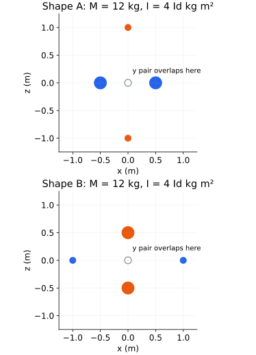
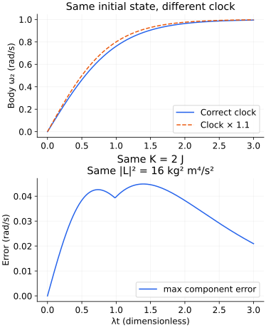

# 관성텐서의 식별 한계와 자유 회전의 시간 검증

2026-11-12. 홈페이지 반영 커밋 `0212803`을 push한 뒤 진행한 다음 두 단원의 연구 예제 준비다. `point-mass-inertia-tensor`와 `torque-free-euler-body-lab`의 기존 한영 본문·입력·수치 구현을 먼저 대조했다. 아래는 **한영 학습 본문에 통합하기 전의 계산 기반**이다. 고전역학 보강은 15/21단원이며 이 준비를 완료 단원으로 추가하지 않는다.

## 1. 관성텐서는 무엇을 관측하고 무엇을 잃는가

질량중심을 원점으로 하고 점질량의 위치를 rᵢ, 질량을 mᵢ>0이라 하자. 질량중심에 대한 이차 모멘트 행렬 S와 관성텐서 I는

$$
S=\sum_i m_i r_i r_i^{\mathsf T},\qquad
I=\operatorname{tr}(S)\operatorname{Id}-S,\qquad
S=\frac{\operatorname{tr}(I)}2\operatorname{Id}-I
$$

로 서로 변환된다. 마지막 식은 tr(I)=2tr(S)에서 나온다. 따라서 관성텐서 전체를 알아도 얻는 것은 질량 분포의 **이차 모멘트**다. 각 점의 위치와 질량을 개별적으로 복원한 것은 아니다. 사진을 몇 개의 요약 통계로 압축하면 원래 사진을 유일하게 되찾기 어려운 것과 같다.

S는 항상 양의 준정부호다. 임의의 n에 대해 nᵀSn=Σmᵢ(n·rᵢ)²≥0이기 때문이다. 주관성모멘트 I₁,I₂,I₃에는

$$
\frac{I_j+I_k-I_i}{2}\ge 0
$$

가 필요하다. 예를 들어 diag(1,1,3)은 양의 정부호지만 대응하는 S=diag(3/2,3/2,−1/2)는 불가능하다. 학습 모델이 양의 정부호 행렬을 출력한다는 사실만으로 물리적 관성텐서라는 결론이 나오지 않는다. 반대로 S의 고유값이 음이 아니면 그 주축의 양·음 방향에 같은 질량을 배치해 해당 이차 모멘트를 실현할 수 있다. 원점 질량이나 반지름 조절로 총질량도 정할 수 있다. 이는 이상적인 점질량 모델의 실현 가능성이고, 특정 재료·외형·연결 구조의 실현까지 보장하지 않는다.

## 2. 질량도 관성도 같지만 서로 다른 두 형상

각 행의 질량은 해당 축의 **한 점**의 질량이고 위치는 ± 쌍이다. 길이는 m, 질량은 kg다. 두 형상 모두 여섯 점이 있고 질량중심은 0이다.

| 형상 | x축 쌍: 질량·위치 | y축 쌍: 질량·위치 | z축 쌍: 질량·위치 |
|---|---|---|---|
| A | 4, ±1/2 | 1, ±1 | 1, ±1 |
| B | 1, ±1 | 1, ±1 | 4, ±1/2 |

두 경우 모두 M=12 kg, S=2Id kg m², I=4Id kg m²다. 어느 각속도를 넣어도 L=4ω와 K=2‖ω‖²가 같다. 같은 텐서를 회전시킨 결과도 같고, 질량까지 같으므로 어느 공통 피벗에 대한 평행축 텐서도 같다. 하지만 x의 사차 모멘트는

$$
\sum_i m_i x_i^4=\begin{cases}1/2&\text{A},\\2&\text{B}\end{cases}
\quad\mathrm{kg\,m^4}
$$

로 다르다. 두 형상은 고정 좌표에서 다른 질량 분포이며 강체의 관성 응답만으로 구별할 수 없다. 두 분포가 좌표 회전으로 대응할 수 있다는 사실도 이 비식별성을 없애지 않는다. 관성이 등방적이므로 그 방향 정보도 사라진다. 밀도 영상이나 더 높은 공간 모멘트처럼 다른 관측이 필요하다.



그림은 xz 투영이며 y축 두 점은 원점에 겹쳐 보인다. 색칠한 점의 면적은 각 점의 질량에 비례한다. 빈 원은 겹친 y축 쌍의 위치 표시다. 투영 그림의 겹침을 실제 입자가 같은 위치에 있다는 뜻으로 읽지 않는다.

기존 실습의 실제 정수 입력 코드는 다음과 같다. 순서는 `[m1,m2,m3,2a,2b,2c,2s,10ωx,10ωy,10ωz,10d,방향코드]`다.

```text
A: [4,1,1,1,2,2,0,10,10,0,0,0]
B: [1,1,4,2,2,1,0,10,10,0,0,0]
```

둘 다 ω=(1,1,0)에서 K=4 J, L=(4,4,0) kg m²/s다. 두 입력의 `10d`를 10으로 바꾸면 O=(1,0,0), I_O=diag(4,16,16), K=10 J다. 질량중심 병진 에너지는 6 J다. 피벗 변경은 기존 실습에서 **물리적 속도장도 변경**하는 비교다. 같은 운동의 관측 원점만 옮긴 것으로 해석하지 않는다. 두 형상이 같은 피벗에서 여전히 구별되지 않는다는 점이 핵심이다.

## 3. 여섯 번의 에너지 관측으로 복원하는 대상

대칭 3×3 텐서는 독립 성분이 여섯 개다. 알려진 각속도 ω_*eᵢ와 ω_*(eᵢ+eⱼ)를 넣고 실제 에너지를 관측하면

$$
I_{ii}=\frac{2K(\omega_*e_i)}{\omega_*^2},\qquad
I_{ij}=\frac{K(\omega_*(e_i+e_j))-K(\omega_*e_i)-K(\omega_*e_j)}{\omega_*^2}
$$

로 복원한다. 여기서 ω_*>0는 알려진 각속도 크기 척도다. 세 축과 세 축 쌍을 썼으므로 여섯 선형 측정의 행렬이 전체 대칭 행렬 공간에서 가역이다. 일반적인 여섯 방향을 임의로 고르면 된다는 뜻은 아니다. ωωᵀ들이 대칭 행렬 공간을 생성해야 한다. 특별한 대각·xz 사전 구조를 알 때는 필요한 관측 수가 줄 수 있다.

독립 검산은 기존 실습에서 구현 가능한 다음 텐서를 사용한다.

$$
I=\begin{pmatrix}26&0&-3\\0&41/2&0\\-3&0&21/2\end{pmatrix}
\quad\mathrm{kg\,m^2}
$$

`[1,1,1,2,4,6,1,10,10,0,0,0]`의 질량·형상·피벗을 유지하고 각속도만 여섯 방향으로 바꾼다. ω_*=1 rad/s에서 에너지는 순서 e₁,e₂,e₃,e₁+e₂,e₁+e₃,e₂+e₃에 대해 13,41/4,21/4,93/4,61/4,31/2 J다. 복원된 Ixz=−3은 위 식의 교차항을 검증한다. 이 정확한 복원으로도 앞의 두 형상을 구별하지 못한다. 측정 잡음이 있으면 차분이 오차를 증폭할 수 있으므로 실험 설계·공분산·물리적 제약을 별도로 검토한다.

## 4. 자유 회전에서 보존량만 맞으면 충분한가

관성텐서에 대한 역문제와 달리 두 번째 문제는 시간 진행의 검증이다. 고정 질량중심, 외부 토크 0, 주축에 대한 I=diag(3,4,5) kg m²를 사용한다. 기존 A,B,C 입력 `[3,2,1]`로 실현 가능한 관성이다. Euler 식은

$$
\dot\omega_1=-\omega_2\omega_3/3,\qquad
\dot\omega_2=\omega_3\omega_1/2,\qquad
\dot\omega_3=-\omega_1\omega_2/5
$$

이다. Ω>0, λ=Ω/√15에 대해 다음 **물체 좌표의 각속도 해**를 직접 대입할 수 있다.

$$
\omega_1=\sqrt{2/3}\,\Omega\operatorname{sech}(\lambda t),\quad
\omega_2=\Omega\tanh(\lambda t),\quad
\omega_3=\sqrt{2/5}\,\Omega\operatorname{sech}(\lambda t)
$$

sech u=1/cosh u이고, (sech u)'=−sech u tanh u, (tanh u)'=sech²u다. 첫째·셋째 성분은 같은 sech 인자로 묶이고 둘째 성분의 미분은 두 sech의 곱이다. 계수 항등식 λ√(2/3)=Ω√(2/5)/3과 λΩ=Ω²√(2/3)√(2/5)/2를 확인하면 세 방정식이 맞는다. 이는 수치 피팅으로 추측한 곡선이 아니다.

sech²u+tanh²u=1을 사용하면 모든 시간에서

$$
K=2\Omega^2,\qquad |L|^2=16\Omega^2
$$

가 된다. 이 식의 수치 단위는 위에 명시한 SI 관성을 따른다. t→−∞와 t→∞에서 각각 음·양 중간 주축의 일정 회전에 접근한다. 불안정한 회전 근처를 잇는 분리 궤도다. 국소 선형 불안정의 λ와 연결되지만 전체 성분이 영원히 지수적으로 커지는 것은 아니다. tanh는 ±1에 포화되고 sech는 유한하다.

이 해의 비주축 초기 성분은 무리수이므로 기존 0.1 rad/s 정수 입력으로 정확히 지정할 수 없다. **별도 Python 해석 예제**로 다루며 실제 화면의 특정 정수 입력을 이 정확한 해라고 표시하지 않는다. 기존 실습의 순수 중간축 `[3,2,1,0,10,0,0,100]`은 그대로 정지한 물체 성분 (0,1,0)을 유지한다. `[3,2,1,1,10,0,0,100]`은 다른, 유한 교란 궤도다. 후자는 K₀=403/200 J, |L₀|²=1609/100이며 위 분리 궤도의 K=2,|L|²=16과 다르다.

## 5. 같은 초기값과 보존량을 갖는 잘못된 시계

참 해를 ω(t)라 하고 후보 예측을 ω̃(t)=ω(ct), c=1.1로 놓자. 초기값은 같고 모든 시간의 K와 |L|²도 정확히 같다. 그러나 같은 실제 시간의 Euler 식은

$$
\frac{d\widetilde\omega}{dt}-f(\widetilde\omega)
=(c-1)f(\widetilde\omega)
$$

라는 잔차를 갖는다. 초기값·보존량·경로의 집합이 같아도 경로를 따라가는 시계는 틀릴 수 있다. Ω=1 rad/s, t=√15 s에서 가장 큰 각속도 성분 오차는 약 0.040 rad/s다. 시간 미분 잔차는 0.009 rad/s²보다 크다.



상단은 물체의 둘째 각속도 성분, 하단은 세 성분의 최대 절대 오차다. 가로축 λt는 무차원이고 두 곡선 모두 Ω=1이다. 에너지·각운동량 보존 손실만으로 학습한 모델은 이런 잘못된 시간을 배제하지 못한다. 시간 관측·운동방정식 잔차·독립 궤도 기준이 필요하다. 실제 미분을 유한 차분으로 추정하면 차분 오차도 별도로 고려해야 한다.

이 해는 각속도 세 성분만 준다. 실험실에서의 자세, 고정된 실험실 각운동량 방향 또는 quaternion을 검증하려면 초기 자세와 자세 수송 방정식을 추가로 적분해야 한다. 이 예제만으로 기존 quaternion 적분기의 전체 정확도를 인증하지 않는다. 기존 독립 회전행렬/DOP853 참조는 별도로 유지한다.

## 6. 재현과 다음 통합

```bash
python3 scripts/learning/verify-rotation-research.py
python3 scripts/learning/verify-rotation-research.py --independent-ode --figures
npx tsx --test scripts/learning-rotation-inertia.test.ts scripts/learning-rotation-research.test.ts
```

첫 명령은 표준 라이브러리만 사용해 점질량 분수 합·여섯 관측 복원·잘못된 물리 텐서와 해석해 483개 표본을 확인한다. 두 번째 명령의 추가 의존성은 NumPy·Matplotlib·SciPy다. 독립 DOP853은 세 Ω에 대해 3궤도·123개 물체 성분 상태를 비교한다. 수치 허용오차 검산이며 엄밀한 구간 ODE 인증은 아니다. 그림은 이 스크립트로 재생성하며, 원고 통합 전의 설명용 자산이다.

일반 이론의 일차 자료는 [MIT 16.07 L26 관성텐서](https://ocw.mit.edu/courses/16-07-dynamics-fall-2009/dd277ec654440f4c2b5b07d6c286c3fd_MIT16_07F09_Lec26.pdf)와 [L28 Euler 식·주축 안정성](https://ocw.mit.edu/courses/16-07-dynamics-fall-2009/5e1d8699338146e5127080b880b906d6_MIT16_07F09_Lec28.pdf)이다. 위 두 형상·관측 설계·시간 재매개화 반례는 이 교재의 계산 예제이며 원자료의 그림을 복제하지 않았다.

다음은 기존 본문과 여섯 연습문제를 보존한 **한영 통합**, 물리량·단위·표·Python·공개 그림의 언어 대조, 기존 실습 입력과 독립 참조, 최종 reader·모바일·접근성·정적 출력 검증이다. 그 이후 접촉 충격량→굴림·미끄럼→민감도→비유일성을 순서대로 진행한다. 전체 51영역·509주제와 13영역·133주제의 후속 검토 범위를 유지한다.

준비 검증 결과: rotation inertia 기존 독립 참조(점질량 600건·Euler 180건)와 신규 인용 입력·여섯 에너지 복원·같은 관성 응답·유한 교란 대칭성을 포함한 **2파일·선택 테스트 33개**가 통과했다. 기존 한영 본문·등록·공개 자산은 이 준비 단계에서 변경하지 않았다.
